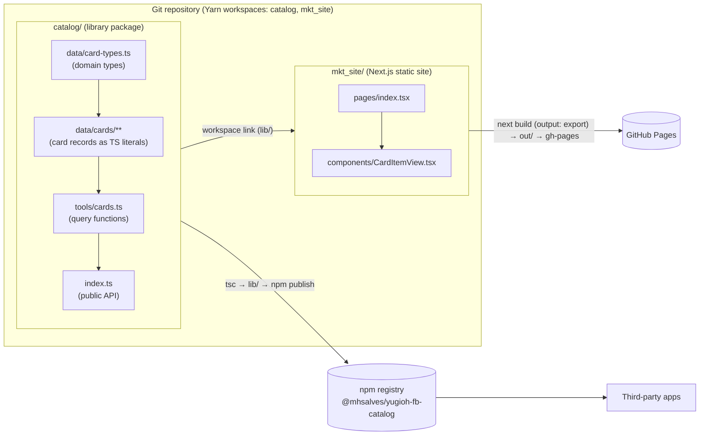
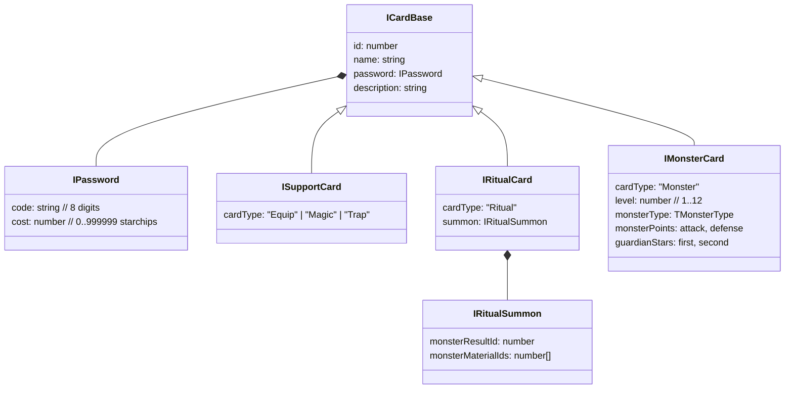
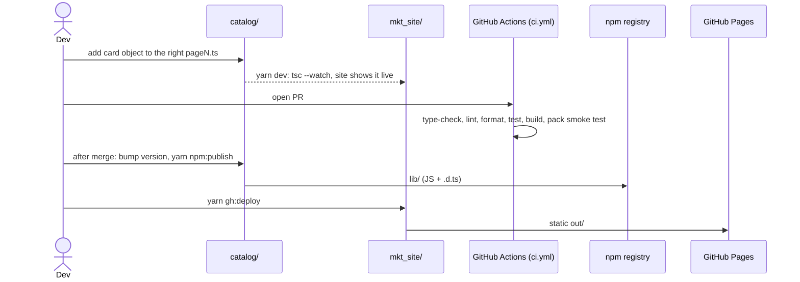

# Architecture

This document describes how the Yu-Gi-Oh! Forbidden Memories catalog is put together, why it is built this way, and what its current state is. It is meant as the starting point for improving the project.

> Some of the reasons below are not written down anywhere in the repository. Where a reason is **inferred** from the code and the git history (and not stated by the author), it is marked *(inferred)*.

---

## 1. What the project is

A typed, offline dataset of the cards in *Yu-Gi-Oh! Forbidden Memories* (PS1, 1999), published in two forms:

1. **An npm library**, `@mhsalves/yugioh-fb-catalog`. It ships the card data plus a few lookup functions.
2. **A static website** on GitHub Pages (`https://mhsalves.github.io/yugioh-fb-catalog`). It uses the library to show which card IDs are in the catalog and which are still missing.

There is no backend, database or API. All of the data is TypeScript source code.

---

## 2. High-level view



The important detail: **the website imports the library from the repository**, through a Yarn workspace link to `catalog/` (built to `catalog/lib/`). A data change shows up on the site without publishing to npm. Before spec 01 the site installed the *published* npm version instead. That check of the shipped package now runs in CI as a packed-tarball smoke test.

---

## 3. Repository layout

```
.
├── package.json             # Private root: Yarn 1 workspaces, scripts, resolutions
├── yarn.lock                # The only lockfile
├── .nvmrc                   # Node 22 for development and CI
├── eslint.config.mjs        # ESLint flat config (typescript-eslint, react-hooks)
├── .prettierrc.json         # Prettier (4 spaces, 120 columns; 2 for JSON/YAML)
├── scripts/check-action-pins.sh  # CI check: every action pinned by commit SHA
├── catalog/                 # The library (current source of truth)
│   ├── package.json         # @mhsalves/yugioh-fb-catalog@0.1.1
│   ├── tsconfig.json        # strict; type-checks src/ + test/
│   ├── tsconfig.build.json  # CommonJS, ES2016, emits lib/ + .d.ts from src/
│   ├── test/                # Vitest: query API + data integrity
│   └── src/
│       ├── index.ts         # Public API: re-exports types + tools
│       ├── data/
│       │   ├── card-types.ts        # Domain model
│       │   ├── duelists/            # Empty placeholder (.gitkeep)
│       │   └── cards/
│       │       ├── index.ts         # Merges every category, sorts by id
│       │       ├── monsters/
│       │       │   └── thunders/page0..3.ts
│       │       ├── rituals/page0..3.ts
│       │       └── support/{equip,magic,trap}.ts
│       └── tools/cards.ts           # Query functions
├── .github/
│   ├── dependabot.yml       # Weekly grouped dependency updates (root workspace + Actions)
│   └── workflows/ci.yml     # CI on every PR and push to main
├── mkt_site/                # Next.js 15 + MUI static site (was server/)
│   ├── next.config.js       # output: 'export', basePath for GH Pages
│   └── src/
│       ├── pages/index.tsx
│       └── components/{Header,CardItemView}.tsx
└── README.md                # Project overview (Portuguese)
```

---

## 4. The library (`catalog/`)

### 4.1 Domain model, `card-types.ts`



`ICard = ISupportCard | IRitualCard | IMonsterCard` is a **discriminated union** on `cardType`.

**Why:**
- The union lets TypeScript narrow types. After `card.cardType === "Monster"`, the compiler knows `card.monsterPoints` exists. `getCardsByMonsterType` relies on this.
- The fields follow the game's own concepts rather than the modern TCG. Forbidden Memories has **guardian stars** and **starchip costs**, and has no attributes. Rituals are modelled as a *recipe*: a result monster plus material monster IDs. The game treats ritual cards this way, so a later fusion or ritual calculator can work on IDs alone.
- **`id` is the in-game card number** (1–722). It is a natural key and needs no extra mapping table.
- References between cards (`monsterResultId`, `monsterMaterialIds`) use plain IDs, not nested objects. The data then stays flat and serialisable, and you can declare cards in any order.

### 4.2 Data storage: cards as TypeScript literals

Every card is an object literal in a `.ts` file, typed against its interface (`IMonsterCard[]`, `IRitualCard[]` or `ISupportCard[]`).

**Why** *(inferred)*:
- **Free validation.** `tsc` checks each record when it compiles. A missing field, a wrong `cardType` or a misspelled guardian star breaks the build. No JSON schema or runtime validator is needed.
- **No I/O.** The data is bundled into the compiled JS, so consumers (Node, browsers, the static site) can `import` it synchronously with no fetch or file read.
- **Easy contributions.** Adding a card means pasting an object into a file that already shows the format.

**Trade-offs:**
- The compiler cannot check value ranges (8-digit password, level 1–12, cost 0–999999), unique IDs, or whether referenced IDs exist. Today these rules exist only as comments.
- The full dataset ends up in every consumer's bundle. At about 722 small records this is acceptable.
- Non-JS consumers (Python scripts, other tools) cannot read the data directly.

### 4.3 Data organization: category → sub-category → "page"

```
cards/index.ts              concat(monsters, rituals, support).sort(by id)
├── monsters/index.ts       concat(thunders)
│   └── thunders/index.ts   concat(page0..page3)
├── rituals/index.ts        concat(page0..page3)
└── support/index.ts        concat(equip, magic, trap)
```

Each `pageN.ts` file holds **one contiguous ID range**, recorded in its header comment. For example, `thunders/page1.ts` holds Thunder monsters 425–460 and `rituals/page1.ts` holds rituals 674–679.

**Why** *(inferred from commits `c8eebe5`, `3857bd4`, `b06fbd3`, `34a8813`)*:
- **Small files.** Splitting about 722 cards over many files keeps diffs and merge conflicts local, and each file stays easy to review.
- **Pages mirror the source.** Contiguous ID ranges match how the in-game library and most reference lists are browsed. One person can fill in one page at a time.
- **Every level is a plain `concat`.** Adding a new monster type (for example `dragons/`) is a new folder plus one line in `monsters/index.ts`.
- **One sort at the root.** File order does not matter, and the exported list is always in ID order.

### 4.4 Public API, `tools/cards.ts` and `index.ts`

| Function | Behaviour |
|---|---|
| `getCardList()` | Every card, sorted by `id` |
| `getCard(id)` | One card or `undefined` (linear `find`) |
| `getCardsByType(cardType)` | Filter on `cardType` |
| `getCardsByMonsterType(monsterType)` | Monsters of one type |

`index.ts` re-exports all types (`export type *`) and the functions above. The raw `data/` modules are not part of the public API.

**Why:** consumers depend on a small function API rather than the file layout, so the data can be reorganised (for example, re-paged) without a breaking change.

### 4.5 Build and publish

- `yarn build` runs `tsc -p tsconfig.build.json` with `module: commonjs`, `target: es2016`, `declaration: true`, output in `lib/`.
- `.npmignore` removes `src/`, `test/` and the TS/Vitest configs, so the package contains only `lib/` (JS + `.d.ts`).
- `yarn npm:publish` builds and publishes. This is still a manual step. CI (`ci.yml`) checks every PR, including a smoke test that installs the packed tarball, but it does not publish.

**Why CommonJS/ES2016** *(inferred)*: it is the format with the widest compatibility. It loads in old and new Node versions and in bundlers such as Next.js/webpack with no extra setup.

---

## 5. The website (`mkt_site/`)

This is **not a server** (it was named `server/` until spec 01 R-6 renamed it). It is a Next.js app built with `output: 'export'` into static HTML/JS in `out/`, then pushed to the `gh-pages` branch.

### 5.1 Behaviour

`pages/index.tsx` renders `TOTAL_CARDS = 721` slots (`CardItemView` for IDs 1..721). Each slot calls `getCard(id)`:
- the card exists → show name, description, type, password and cost
- the card is missing → show "Not available yet", or hide it when the **Only Available** switch is on (the default)

In practice, the site is a **coverage report** for the dataset: it shows how much of the game has been entered.

### 5.2 Stack and reasons

| Choice | Reason |
|---|---|
| Next.js with static export | The data is static and bundled, so no server is needed. Static export works on free GitHub Pages hosting. Commit `2e50981` removed an earlier Express/nodemon server for this reason. |
| `basePath`/`assetPrefix` `/yugioh-fb-catalog` in production | GitHub Pages serves project sites under `/<repo>/`. |
| `images.unoptimized` | Next's image optimiser needs a running server, which static export does not have. |
| `touch out/.nojekyll` | Stops GitHub Pages' Jekyll from ignoring the `_next/` folder (Jekyll skips paths that start with an underscore). |
| MUI + Toolpad `PageContainer` | Ready-made, decent-looking components without writing CSS. |
| Depends on the **workspace** catalog (`"*"`, linked by Yarn) | Data changes appear on the site without publishing. Earlier the site depended on the published npm package, so it doubled as a real consumer *(inferred)*. That check now runs in CI as a packed-tarball smoke test. |
| TypeScript `strict: true` | Same as the catalog (spec 01 R-5). |

### 5.3 Deploy

```
yarn gh:deploy  =  next build  →  touch out/.nojekyll  →  gh-pages -d out
```

This runs manually from a developer machine, inside `mkt_site/` (after `yarn build` at the root, so the catalog's `lib/` exists).

---

## 6. End-to-end flow for a data change



Publishing and deploying are still manual. They are automated in specs [05](./specs/05-catalog-npm-distribution.md) N-2 and [07](./specs/07-site-github-pages-delivery.md) P-1.

---

## 7. Current state and known issues

Checked on 2026-10-20 against `main` @ `4d80225`; tooling items (S3, Q1–Q3, Q5) rechecked after the spec 01 build. Both packages type-check cleanly in strict mode (`yarn typecheck`).

### 7.1 Data coverage
Only **6 of about 722 cards** have been entered: 1 Thunder monster (425), 1 ritual (674), and 1 each of equip (315), magic (332) and trap (690). Most `pageN.ts` files are empty arrays with a range comment. `TMonsterType` has only `"Thunder" | "Dragon"`, and `data/duelists/` is an empty placeholder (probably intended for duelist drop and deck tables).

### 7.2 Structural problems
| # | Issue | Evidence | Impact |
|---|---|---|---|
| S1 | ~~**Duplicated library.**~~ **Resolved.** Commit `7f15bd0` "Move all catalog files to a folder" *copied* `src/` into `catalog/src/` instead of moving it. The stale root `src/`, `package.json` (v0.1.0), `tsconfig.json`, `yarn.lock` and `.npmignore` have since been deleted. | — | — |
| S2 | ~~**Dependency drift between the copies.**~~ **Resolved** together with S1. | — | — |
| S3 | ~~**No workspace linking.**~~ **Resolved** by spec 01 R-1: a Yarn workspace links `mkt_site/` to `catalog/`. | — | — |
| S4 | **Hard-coded card count** `TOTAL_CARDS = 721` in the UI. FM has 722 cards (verify). | `mkt_site/src/pages/index.tsx` | Duplicates knowledge that belongs in the library, and may be off by one. |
| S5 | **README docs do not match the code.** `src/README.md` and `catalog/README.md` describe `getCards`, `getCardById(id: string)`, string IDs, lowercase types and an `attribute` field, none of which exist. `mkt_site/README.md` lists search, theming, stats, `styles/`, `utils/` and `NEXT_PUBLIC_API_URL`, also not present. Reference links are `(URL)` placeholders. | READMEs vs `card-types.ts` / `tools/cards.ts` | Misleads contributors and package users. |

### 7.3 Quality and tooling gaps
| # | Issue |
|---|---|
| Q1 | ~~No tests.~~ **Mostly resolved** by spec 01 R-2: Vitest covers the query API and data integrity (unique and sorted IDs, ranges, password format, ritual references in range). Still missing: ritual references pointing to *existing* monsters, page ranges matching the header comments. |
| Q2 | ~~No CI.~~ **Partly resolved** by spec 01 R-4: `ci.yml` type-checks, lints, tests and builds every PR (including Dependabot's). Publishing to npm and deploying to Pages are still manual. |
| Q3 | ~~No linter or formatter.~~ **Resolved** by spec 01 R-3: ESLint (flat config) and Prettier at the root. |
| Q4 | `getCard` is a linear scan, called 721 times per render (O(n²)). This is negligible at the current size but trivial to fix with a `Map` index. |
| Q5 | ~~The site has `strict: false`.~~ **Resolved** by spec 01 R-5. |
| Q6 | The library emits only CommonJS/ES2016, with no `exports` map or ESM build. |
| Q7 | The site shows only base fields. Monster stats, guardian stars and ritual recipes are in the data but not rendered. There is no search or filtering beyond the availability toggle. |

---

## 8. Suggested improvement roadmap

> Detailed, reviewable proposals for each item below live in [`specs/`](./specs/README.md).

Ordered so that each step makes the next one safer.

1. ~~**Single source of truth (S1, S2).**~~ Done: the root copy was deleted and `catalog/` is the only library.
2. ~~**Monorepo workspaces (S3).**~~ Done (spec 01 R-1): root `package.json` with `"workspaces": ["catalog", "mkt_site"]` (Yarn 1). The site imports the local library, and data changes appear immediately.
3. ~~**Tests and integrity checks (Q1).**~~ Done for the current data (spec 01 R-2): Vitest asserts unique and sorted IDs, value ranges and ritual references in range. Reference and page-range checks grow with the data ([03](./specs/03-catalog-data-authoring.md) A-2).
4. **CI (Q2).** Partly done (spec 01 R-4): `ci.yml` type-checks, lints, tests and builds both packages on every PR. Still to do: automate the Pages deploy on push to `main` ([07](./specs/07-site-github-pages-delivery.md) P-1) and npm publishing ([05](./specs/05-catalog-npm-distribution.md) N-2).
5. **Fix the docs (S5).** Rewrite the READMEs from the real API, or generate API docs with TypeDoc, and link to this file.
6. **Library API polish (S4, Q4, Q6).** Export `TOTAL_CARDS` and a progress helper, index cards in a `Map` for `getCard`, and consider a dual ESM/CJS build with an `exports` map.
7. **Fill in the data (§7.1).** Extend `TMonsterType` to every FM type, add the matching `monsters/<type>/` folders, and decide on the shape of `duelists/` (drop tables, decks). Consider a scraper or importer script in `tools/` that generates the page files from a trusted source.
8. **Website features (Q7).** Add a card detail view, search, filters by type, monster type and stars, a progress bar, and, once the data exists, fusion or ritual lookups.
