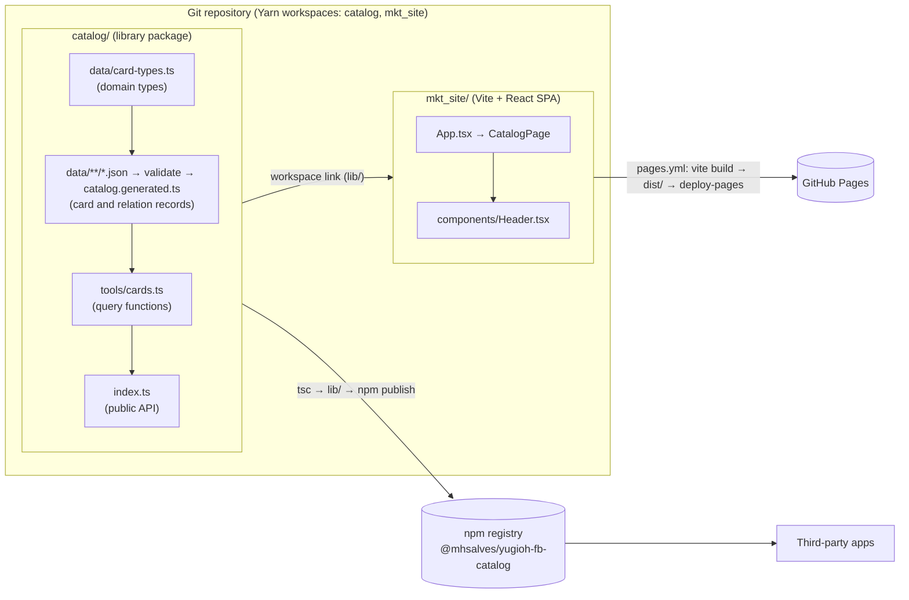
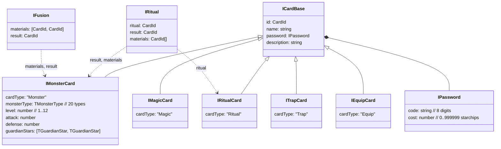
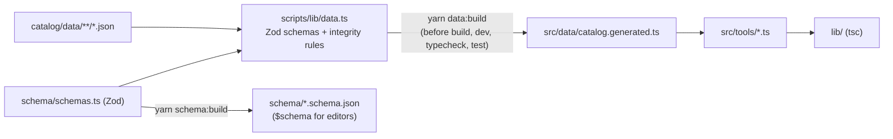
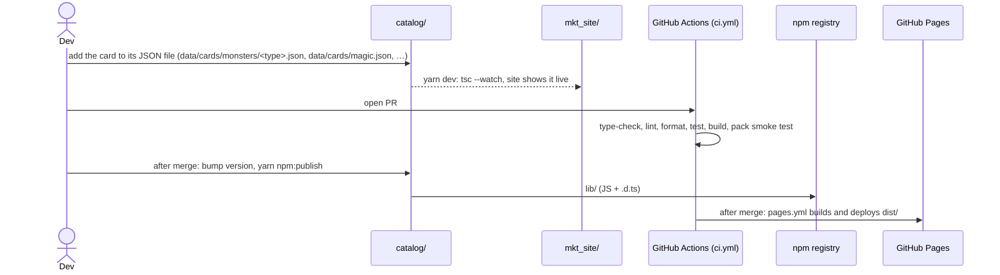

# Architecture

This document describes how the Yu-Gi-Oh! Forbidden Memories catalog is put together, why it is built this way, and what its current state is. It is meant as the starting point for improving the project.

> Some of the reasons below are not written down anywhere in the repository. Where a reason is **inferred** from the code and the git history (and not stated by the author), it is marked *(inferred)*.

---

## 1. What the project is

A typed, offline dataset of the cards in *Yu-Gi-Oh! Forbidden Memories* (PS1, 1999), published in two forms:

1. **An npm library**, `@mhsalves/yugioh-fb-catalog`. It ships the card data plus a few lookup functions.
2. **A static website** on GitHub Pages (`https://mhsalves.github.io/yugioh-fb-catalog`). It uses the library to show which card IDs are in the catalog and which are still missing.

There is no backend, database or API. All of the data is JSON files in the repository (`catalog/data/`), validated and compiled into the library at build time.

---

## 2. High-level view



The important detail: **the website imports the library from the repository**, through a Yarn workspace link to `catalog/` (built to `catalog/lib/`). A data change shows up on the site without publishing to npm. Before spec 01 the site installed the *published* npm version instead. That check of the shipped package now runs in CI as a packed-tarball smoke test.

---

## 3. Repository layout

```
.
├── package.json             # Private root: Yarn 1 workspaces, scripts, resolutions
├── yarn.lock                # The only lockfile
├── .nvmrc                   # Node 22 for development and CI
├── eslint.config.mjs        # ESLint flat config (typescript-eslint, react-hooks)
├── .prettierrc.json         # Prettier (4 spaces, 120 columns; 2 for JSON/YAML)
├── scripts/check-action-pins.sh  # CI check: every action pinned by commit SHA
├── catalog/                 # The library (current source of truth)
│   ├── package.json         # @mhsalves/yugioh-fb-catalog@0.2.0
│   ├── CHANGELOG.md         # Release notes, with migration notes for breaking changes
│   ├── CONTRIBUTING-DATA.md # How to add data (PT-BR), with templates
│   ├── tsconfig.json        # strict; type-checks src/, test/, schema/, scripts/
│   ├── tsconfig.build.json  # CommonJS, ES2016, emits lib/ + .d.ts from src/
│   ├── data/                # All data, as JSON (spec 03)
│   │   ├── cards/monsters/<type>.json   # one file per monster type (thunder.json today)
│   │   ├── cards/{magic,trap,equip,ritual}.json
│   │   ├── rituals.json  equips.json  fields.json  fusions/<type>.json   # relations
│   │   ├── rules.json               # totalCards, guardian-star advantage and bonus
│   │   └── duelists/                # Empty placeholder (.gitkeep), waits for TBD-D9
│   ├── schema/              # schemas.ts (Zod, dev-only) + generated <name>.schema.json
│   ├── scripts/             # validate, data:build (+ --watch), schema:build, coverage:data
│   ├── test/                # Vitest: query API, data integrity, validator fixtures
│   └── src/
│       ├── index.ts         # Public API: re-exports types, enums, rules + tools
│       ├── data/
│       │   ├── enums.ts             # MONSTER_TYPES, CARD_TYPES, GUARDIAN_STARS (runtime lists)
│       │   ├── rules.ts             # TOTAL_CARDS, … read from rules.json
│       │   ├── card-types.ts        # Card entities (types derived from enums.ts)
│       │   ├── relation-types.ts    # IFusion, IRitual, IEquipCompat, IFieldEffect
│       │   └── catalog.generated.ts # Written by `yarn data:build` (git-ignored)
│       └── tools/{cards,relations}.ts   # Query functions
├── .github/
│   ├── dependabot.yml       # Weekly grouped dependency updates (root workspace + Actions)
│   └── workflows/ci.yml     # CI on every PR and push to main
├── mkt_site/                # Vite + React SPA, plain CSS (was server/, then Next.js + MUI)
│   ├── vite.config.ts       # base path for GH Pages, 404.html fallback, catalog version
│   ├── index.html
│   └── src/
│       ├── App.tsx, router.tsx, catalogUrl.ts, useCopy.ts, styles.css
│       ├── pages/{CatalogPage,NotFoundPage}.tsx
│       └── components/{Header,CatalogVersion,icons}.tsx
└── README.md                # Project overview (Portuguese)
```

---

## 4. The library (`catalog/`)

### 4.1 Domain model, `card-types.ts`, `relation-types.ts`, `enums.ts`, `rules.ts`

Shaped by [spec 02](./specs/02-catalog-data-model.md) (catalog `0.2.0`).



`ICard = IMonsterCard | IMagicCard | ITrapCard | IEquipCard | IRitualCard` is a **discriminated union** on `cardType`. `ISupportCard` is the union of the Magic, Trap and Equip cards.

**Why:**
- The union lets TypeScript narrow types. After `card.cardType === "Monster"`, the compiler knows `card.attack` exists. `getCardsByMonsterType` relies on this.
- The fields follow the game's own concepts rather than the modern TCG. Forbidden Memories has **guardian stars** and **starchip costs**. Whether it has attributes is still open (TBD-D3).
- **Cards are entities; game mechanics are relations** (spec 02 D-1). Ritual recipes, fusions, equip compatibility and field effects are separate collections keyed by card ID, so a fusion between two cards is not duplicated in both, and relation data can grow without reshaping cards. Fusions are stored as the game stores them: specific card pairs, sorted, one entry per pair.
- **`id` is the in-game card number** (1–`TOTAL_CARDS`, 722). It is a natural key and needs no extra mapping table.
- References use plain IDs, not nested objects. The data then stays flat and serialisable, and you can declare cards in any order.
- **Enumerations are runtime lists** (`MONSTER_TYPES`, `CARD_TYPES`, `GUARDIAN_STARS` in `enums.ts`), and the TS types derive from them. The site's filters and the types cannot drift apart. **Rule values** (`TOTAL_CARDS`, `GUARDIAN_STAR_ADVANTAGE`, `GUARDIAN_STAR_BONUS`) are data in `catalog/data/rules.json`. Every game fact is sourced in spec 02 §6.

### 4.2 Data storage: JSON validated by schemas, compiled into the library

[Spec 03](./specs/03-catalog-data-authoring.md) A-1. Every record lives in a JSON file under `catalog/data/`. Each file is `{ "$schema": "<relative path to its JSON Schema>", "<list>": [ … ] }` (`rules.json` holds the rule values instead of a list).



- **Validation before every build.** `scripts/lib/data.ts` checks each file against its Zod schema (shape, ranges, 8-digit passwords, enums, unknown fields) and then the cross-file rules: unique IDs, IDs within `totalCards`, monster type matching its file, relation references, fusion pairs. Errors fail `yarn validate`, the build and CI. A relation pointing at a card not entered yet is only a warning (TBD-A3). Every rule has a failing-fixture test.
- **Editors validate as you type.** Zod exports draft-07 JSON Schemas into `catalog/schema/`, and each data file points at its schema with `$schema`. Tests fail if the committed schemas are stale.
- **One source for types.** The public interfaces in `card-types.ts` and `relation-types.ts` stay hand-written for readable `.d.ts` files, and `schemas.ts` asserts at compile time that each one equals what its schema accepts. Zod is a dev dependency only; consumers do not install it.
- **No I/O at runtime.** `yarn data:build` writes the validated data into `src/data/catalog.generated.ts` (git-ignored), which `tsc` compiles into `lib/`. Consumers (Node, browsers, the static site) still `import` the data synchronously, with no fetch, file read or runtime validation. `yarn dev` watches `catalog/data/`, so a saved JSON edit appears on the running site.

**Why JSON** (agreed in spec 03): it can be edited in the GitHub web UI with no tooling, it suits bulk entry (thousands of fusions), it is readable by non-JS tools and importers, and adding a data file needs no `index.ts` or code change.

**Trade-offs:**
- The full dataset ends up in every consumer's bundle. At about 722 small records this is acceptable.
- The JSON files are not shipped in the npm package yet (spec 05 TBD-N5).

### 4.3 Data organization: one file per card type (and monster type)

```
data/cards/monsters/<monster-type>.json   // thunder.json today; winged-beast.json, sea-serpent.json, …
data/cards/magic.json  trap.json  equip.json  ritual.json
data/rituals.json  equips.json  fields.json  fusions/<result-type>.json  rules.json
```

**One rule** (spec 02 D-5): a card goes in the file for its `cardType`, and a monster goes in `cards/monsters/<monster-type>.json`. The validator rejects a monster in another type's file and file names that are not a monster type. `data:build` merges every file and sorts the cards by ID.

**Why:**
- **One rule to learn.** The earlier layout had three: monsters by type and then by unverified ID-range "pages", rituals by page only, and support cards by type only.
- **Small files by sub-type.** Files stay reviewable without the `pageN` ID ranges, whose meaning was never verified (TBD-D4).
- **One sort at the root.** File order does not matter, and the exported list is always in ID order.

### 4.4 Public API, `tools/*.ts` and `index.ts`

| Export | Behaviour |
|---|---|
| `getCardList()` | Every card, sorted by `id` |
| `getCard(id)` | One card or `undefined` (linear `find`) |
| `getCardsByType(cardType)` | Filter on `cardType` |
| `getCardsByMonsterType(monsterType)` | Monsters of one type (`IMonsterCard[]`) |
| `getRitual(ritualOrResultId)` | Ritual recipe `{ ritual, result, materials }` or `undefined` |
| `TOTAL_CARDS`, `MONSTER_TYPES`, `CARD_TYPES`, `GUARDIAN_STARS`, `GUARDIAN_STAR_ADVANTAGE`, `GUARDIAN_STAR_BONUS` | Game enumerations and rule values |

`index.ts` re-exports all card and relation types (`export type *`), the enums and rules, and the functions above. The raw `data/` modules are not part of the public API.

**Why:** consumers depend on a small function API rather than the file layout, so the data can be reorganised (for example, re-paged) without a breaking change.

### 4.5 Build and publish

- `yarn build` runs `tsc -p tsconfig.build.json` with `module: commonjs`, `target: es2016`, `declaration: true`, output in `lib/`.
- `"files": ["lib"]` in `catalog/package.json` allowlists the build output, so the package contains only `lib/` (JS + `.d.ts`) plus `README.md` and `package.json`. The allowlist is required inside the workspace: npm also applies the root `.gitignore`, which ignores `lib`, so without it the tarball would be empty. `.npmignore` is kept as a second guard.
- `yarn npm:publish` builds and publishes. This is still a manual step. CI (`ci.yml`) checks every PR, including a smoke test that installs the packed tarball, but it does not publish.

**Why CommonJS/ES2016** *(inferred)*: it is the format with the widest compatibility. It loads in old and new Node versions and in bundlers such as Next.js/webpack with no extra setup.

---

## 5. The website (`mkt_site/`)

This is **not a server** (it was named `server/` until spec 01 R-6 renamed it). It is a Vite + React single-page app built into static files in `dist/`, then deployed by GitHub Actions (`pages.yml`). It replaced a Next.js 15 + MUI 6 static export (spec 06 U-4).

### 5.1 Behaviour

The site is **one page** (spec 09): the catalog at `/`.
- **Header:** logo (back to the full catalog), the **catalog version** the site was built with (click to copy `@mhsalves/yugioh-fb-catalog@<version>`) and a link to that version on npm. No menu.
- **Filters:** a search box and a "By type" row ("All types" + the 5 card types) above the grid; a panel with the other `CardQuery` fields (monster type, guardian star, level, ATK, DEF, cost, description search). A left column on desktop, a full-screen sheet on phones.
- **Results:** the page calls `searchCards(query)` from the catalog and renders the items as a grid, with "N cards · 5 of 722 catalogued" and a sort control. Zero results show a placeholder with "Clear filters". The site never filters or sorts by itself.
- **Card details:** clicking a grid item opens a `<dialog>` with the card's stats, guardian stars, copyable password, cost, description and ritual recipe (`getRitual`), plus previous/next through the results.
- **URL:** the whole state lives in the query string (`catalogUrl.ts`), for example `?type=Monster&atk=1000-&card=425`. Filter changes replace the history entry; opening a card adds one, so Back closes it.
- **Footer:** "Made by Matheus Alves" with links to https://matheusalves.dev and https://github.com/mhsalves.
- A **404** view for any other path.

### 5.2 Stack and reasons

| Choice | Reason |
|---|---|
| Vite + React, no framework | The data is static and bundled, so no server or SSR is needed. Vite builds in under a second and outputs plain HTML/JS/CSS for GitHub Pages. |
| Plain CSS with tokens in `src/styles.css` | No UI or CSS-in-JS library to update. Colors and fonts live in `:root` variables, ready for the style guide (spec 06 U-1). |
| Own router (`src/router.tsx`, ~70 lines) | History API + `useSyncExternalStore` for the path and the query string; avoids a router dependency for one page. |
| Inline SVG icons (`components/icons.tsx`) | No icon library. |
| `base` from `SITE_BASE_PATH`, default `/yugioh-fb-catalog/` for build and preview | GitHub Pages serves project sites under `/<repo>/` (spec 07 P-3). |
| `dist/404.html` = copy of `index.html` | Pages serves `404.html` for unknown paths, so deep links boot the SPA and its router shows the page or the 404 view. |
| Catalog version injected at build (`define` in `vite.config.ts`) | Shows exactly which catalog the site was built against without shipping `package.json`. |
| Depends on the **workspace** catalog (`"*"`, linked by Yarn) | Data changes appear on the site without publishing. The packed-tarball smoke test in CI checks the npm consumer path. |
| TypeScript `strict: true` | Same as the catalog (spec 01 R-5). |

### 5.3 Deploy

`.github/workflows/pages.yml` deploys after every merge to `main` that changes the site, the catalog data or code, or the dependencies (spec 07 P-1): validate → test → `yarn build` (base path from `actions/configure-pages`) → upload `mkt_site/dist` → `actions/deploy-pages`. It can also be started by hand (`workflow_dispatch`) to redeploy without changes. There is no manual deploy script any more (the `gh-pages` package and `gh:deploy` were removed after the first Actions deploy, 2026-10-20). No `.nojekyll` is needed: Vite's output has no `_`-prefixed folders.

---

## 6. End-to-end flow for a data change



The site deploy is automated ([07](./specs/07-site-github-pages-delivery.md) P-1). Publishing to npm is still manual; it is automated in spec [05](./specs/05-catalog-npm-distribution.md) N-2.

---

## 7. Current state and known issues

Checked on 2026-10-20 against `main` @ `4d80225`; tooling items (S3, Q1–Q3, Q5) rechecked after the spec 01 build. Both packages type-check cleanly in strict mode (`yarn typecheck`).

### 7.1 Data coverage
Only **5 of 722 cards** have been entered: 1 Thunder monster (425), 1 ritual (674, with its recipe in `data/rituals.json`), and 1 each of equip (315), magic (332) and trap (690). (This section said 6 before; the count was wrong.) The model now covers all 20 monster types (spec 02), but only `data/cards/monsters/thunder.json` has data. `yarn coverage:data` prints these counts. The fusion, equip and field collections are typed and empty, and `data/duelists/` waits for TBD-D9.

### 7.2 Structural problems
| # | Issue | Evidence | Impact |
|---|---|---|---|
| S1 | ~~**Duplicated library.**~~ **Resolved.** Commit `7f15bd0` "Move all catalog files to a folder" *copied* `src/` into `catalog/src/` instead of moving it. The stale root `src/`, `package.json` (v0.1.0), `tsconfig.json`, `yarn.lock` and `.npmignore` have since been deleted. | — | — |
| S2 | ~~**Dependency drift between the copies.**~~ **Resolved** together with S1. | — | — |
| S3 | ~~**No workspace linking.**~~ **Resolved** by spec 01 R-1: a Yarn workspace links `mkt_site/` to `catalog/`. | — | — |
| S4 | ~~**Hard-coded card count.**~~ **Resolved** by spec 02 D-4: the site imports `TOTAL_CARDS` (722, verified) from the library. | — | — |
| S5 | **README docs do not match the code.** `src/README.md` and `catalog/README.md` describe `getCards`, `getCardById(id: string)`, string IDs, lowercase types and an `attribute` field, none of which exist. `mkt_site/README.md` lists search, theming, stats, `styles/`, `utils/` and `NEXT_PUBLIC_API_URL`, also not present. Reference links are `(URL)` placeholders. | READMEs vs `card-types.ts` / `tools/cards.ts` | Misleads contributors and package users. |

### 7.3 Quality and tooling gaps
| # | Issue |
|---|---|
| Q1 | ~~No tests.~~ **Mostly resolved** by spec 01 R-2: Vitest covers the query API and data integrity (unique and sorted IDs, ranges, password format, ritual references in range). Still missing: ritual references pointing to *existing* monsters, page ranges matching the header comments. |
| Q2 | ~~No CI.~~ **Partly resolved** by spec 01 R-4: `ci.yml` type-checks, lints, tests and builds every PR (including Dependabot's). Publishing to npm is still manual; `pages.yml` deploys the site on merge (spec 07 P-1). |
| Q3 | ~~No linter or formatter.~~ **Resolved** by spec 01 R-3: ESLint (flat config) and Prettier at the root. |
| Q4 | `getCard` is a linear scan, called 722 times per render (O(n²)). This is negligible at the current size but trivial to fix with a `Map` index. |
| Q5 | ~~The site has `strict: false`.~~ **Resolved** by spec 01 R-5. |
| Q6 | The library emits only CommonJS/ES2016, with no `exports` map or ESM build. |
| Q7 | The site shows only base fields. Monster stats, guardian stars and ritual recipes are in the data but not rendered. There is no search or filtering beyond the availability toggle. |

---

## 8. Suggested improvement roadmap

> Detailed, reviewable proposals for each item below live in [`specs/`](./specs/README.md).

Ordered so that each step makes the next one safer.

1. ~~**Single source of truth (S1, S2).**~~ Done: the root copy was deleted and `catalog/` is the only library.
2. ~~**Monorepo workspaces (S3).**~~ Done (spec 01 R-1): root `package.json` with `"workspaces": ["catalog", "mkt_site"]` (Yarn 1). The site imports the local library, and data changes appear immediately.
3. ~~**Tests and integrity checks (Q1).**~~ Done for the current data (spec 01 R-2): Vitest asserts unique and sorted IDs, value ranges and ritual references in range. Reference and page-range checks grow with the data ([03](./specs/03-catalog-data-authoring.md) A-2).
4. **CI (Q2).** Partly done (spec 01 R-4): `ci.yml` type-checks, lints, tests and builds both packages on every PR. Still to do: automate the Pages deploy on push to `main` ([07](./specs/07-site-github-pages-delivery.md) P-1) and npm publishing ([05](./specs/05-catalog-npm-distribution.md) N-2).
5. **Fix the docs (S5).** Rewrite the READMEs from the real API, or generate API docs with TypeDoc, and link to this file.
6. **Library API polish (Q4, Q6).** (`TOTAL_CARDS` is exported since spec 02.) Add a progress helper, index cards in a `Map` for `getCard`, and consider a dual ESM/CJS build with an `exports` map.
7. **Fill in the data (§7.1).** `TMonsterType` already covers every FM type (spec 02); add each `data/cards/monsters/<type>.json` file with its first card (see `catalog/CONTRIBUTING-DATA.md`), fill the relation collections, and decide on the shape of `duelists/` (TBD-D9). Consider an importer script that generates the data files from a trusted source (spec 03 A-5).
8. **Website features (Q7).** Add a card detail view, search, filters by type, monster type and stars, a progress bar, and, once the data exists, fusion or ritual lookups.
