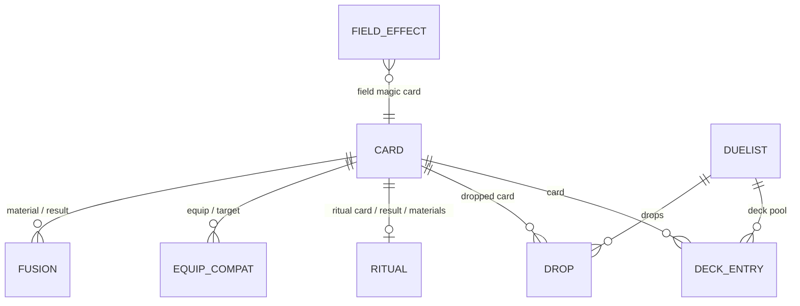

# 02 – Catalog data model and organization

> **Status: Proposed.** Many items are **TBD** because they are game facts that must be checked against a trusted source (see TBD-X1 in the [index](./README.md)) before they are coded.

## 1. Why this spec exists

Goal **G6**: the catalog must organize the data **correctly by card type and the other game concepts**. *Forbidden Memories* (FM) has its own rules, different from the modern TCG. Fusions, guardian stars, starchip costs, equip compatibility and duelist drops are what players actually look up. If the model does not capture these concepts as first-class data:

- the query API ([04](./04-catalog-query-api.md)) cannot answer the questions players ask ("what can I fuse with X?", "who drops Y?");
- the site ([06](./06-site-ux-forbidden-memories.md)) cannot reproduce the feel of the in-game card screens;
- adding these concepts later would change the shape of every card, which is a breaking change for npm consumers.

Designing the full shape now (even if most of it stays empty) lets the data grow **without breaking changes**.

## 2. What exists today

`catalog/src/data/card-types.ts` (details in `ARCHITECTURE.md` §4.1):

```ts
type TSupportCardType = "Equip" | "Magic" | "Trap";
type TCardType       = TSupportCardType | "Monster" | "Ritual";
type TMonsterType    = "Thunder" | "Dragon";               // only 2 of the game's types
type TGuardianStars  = "Sun" | "Mercury" | "Venus" | "Moon" | "Mars"
                     | "Jupiter" | "Saturn" | "Uranus" | "Neptune" | "Pluto";

ICardBase     { id, name, password: { code, cost }, description }
IMonsterCard  { cardType: "Monster", level, monsterType, monsterPoints: { attack, defense }, guardianStars: { first, second } }
IRitualCard   { cardType: "Ritual", summon: { monsterResultId, monsterMaterialIds[] } }
ISupportCard  { cardType: "Equip" | "Magic" | "Trap" }
ICard = IMonsterCard | IRitualCard | ISupportCard          // discriminated on cardType
```

Folder organization:

```
cards/
├── monsters/thunders/page0..3.ts   # Thunder monsters, split by ID range
├── rituals/page0..3.ts             # Rituals, split by ID range (665–721)
└── support/{equip,magic,trap}.ts
duelists/                            # empty placeholder
```

**Data entered: 5 cards** (IDs 315 Dragon Treasure, 332 Mountain, 425 Thunder Dragon, 674 Beastry Mirror Ritual, 690 Fake Trap). `ARCHITECTURE.md` §7.1 says 6; this should be corrected to 5.

**What is already good and should be kept:**
- The discriminated union on `cardType`, which gives type narrowing for free.
- `id` = in-game card number (the natural key).
- Cross-references use plain IDs (`monsterResultId`, `monsterMaterialIds`), so the data stays flat and serializable.
- The model follows FM's concepts (guardian stars, starchips), not the modern TCG's.

## 3. Gaps

| # | Gap |
|---|---|
| D-gap-1 | `TMonsterType` lists 2 types. FM has about 20 (**TBD-D1**). |
| D-gap-2 | Folder organization differs by category: monsters are grouped by type and then by ID range, rituals only by ID range, support only by type. A contributor has to learn three rules. |
| D-gap-3 | The ID ranges in the `pageN.ts` headers are not verified and do not appear in any game list. For example, `thunders/page0.ts` covers "045–371", which is a very wide range for one type. Their meaning is unclear (**TBD-D4**). |
| D-gap-4 | No **fusion** data, the core mechanic of FM. |
| D-gap-5 | No **equip compatibility** (which monsters each equip card can target, and the boost). |
| D-gap-6 | No **field-card effects** (for example, Mountain boosts Dragon, Winged Beast and Thunder). |
| D-gap-7 | No **duelist** data (decks, drop tables). The folder exists but is empty. |
| D-gap-8 | Magic and Trap have no sub-classification (field, damage, heal, destroy, power-up and so on). |
| D-gap-9 | No **attribute** field. `ARCHITECTURE.md` says FM has no attributes. Some community databases list attributes for FM cards, so this needs verifying (**TBD-D3**). |
| D-gap-10 | The game's rules are not data: the guardian-star advantage cycle and the total card count (`721` is hard-coded in the site, while FM is believed to have 722). |

## 4. Proposed improvements

### D-1 Separate *entities* from *relations*
Card records describe **what a card is**. Game mechanics that link cards (fusions, equips, rituals, drops) live in their **own collections**, keyed by ID. The reasons:

- one fusion involves 2–3 cards, so storing it inside a card would duplicate it;
- relations can be filled in independently, by different contributors, at different times;
- the card shape stays stable while relation data grows.



### D-2 Card entity (target shape)

```ts
interface ICardBase {
  id: CardId;                 // 1..TOTAL_CARDS, in-game number
  name: string;               // English name; see TBD-X2 for localization
  description: string;
  password: { code: string; cost: number };   // code: 8 digits; cost: starchips
  // TBD-D6: rarity / in-game "card number" display, artwork reference
}

interface IMonsterCard extends ICardBase {
  cardType: "Monster";
  monsterType: TMonsterType;           // full list, TBD-D1
  level: number;                       // 1..12
  attack: number; defense: number;     // flatten monsterPoints? TBD-D7
  guardianStars: [TGuardianStar, TGuardianStar];
  attribute?: TAttribute;              // TBD-D3
}

interface IMagicCard extends ICardBase {
  cardType: "Magic";
  magicKind?: TMagicKind;              // TBD-D5: "Field" | "Damage" | "Heal" | "Destroy" | "PowerUp" | ...
}
interface ITrapCard   extends ICardBase { cardType: "Trap";  trapKind?: TTrapKind }   // TBD-D5
interface IEquipCard  extends ICardBase { cardType: "Equip" }
interface IRitualCard extends ICardBase { cardType: "Ritual" }   // the recipe moves to rituals.ts (D-3)

type ICard = IMonsterCard | IMagicCard | ITrapCard | IEquipCard | IRitualCard;
```

Splitting `ISupportCard` into `IMagicCard`, `ITrapCard` and `IEquipCard` lets each one gain its own fields without optional-field sprawl.

**Compatibility:** renaming or flattening fields (`monsterPoints` → `attack`/`defense`, the `guardianStars` object → tuple, `summon` moving out) is **breaking**. Either do it in a `0.x` minor (allowed under semver for 0.x) with a migration note, or keep the old fields as deprecated getters for one release (**TBD-D7**).

### D-3 Relation collections

```ts
// fusions.ts
interface IFusion {
  result: CardId;
  materials: [MaterialRef, MaterialRef];       // order-insensitive
}
type MaterialRef =
  | { card: CardId }                           // specific card
  | { monsterType: TMonsterType }              // "any Dragon"   ┐ TBD-D2: how generic fusions
  | { group: string };                         // "any Female"   ┘ are expressed in FM

// equips.ts
interface IEquipCompat { equip: CardId; targets: CardId[]; boost: number }  // boost usually 500, TBD-D8

// rituals.ts  (moved out of IRitualCard.summon)
interface IRitual { ritual: CardId; result: CardId; materials: CardId[] }

// fields.ts
interface IFieldEffect { field: CardId; boosts: TMonsterType[]; weakens: TMonsterType[]; amount: number } // TBD-D8

// duelists.ts
interface IDuelist { id: string; name: string; campaignStage?: string /* TBD-D9 */ }
interface IDeckEntry { duelist: string; card: CardId; weight: number }
interface IDrop {
  duelist: string; card: CardId; weight: number;
  rank: "S/A-POW" | "B/C/D" | "S/A-TEC"        // TBD-D9: rank categories
}
```

### D-4 Game rules as data (`rules.ts`)

```ts
export const TOTAL_CARDS = 722;                       // TBD-D10: confirm 722 vs 721
export const MONSTER_TYPES = [/* full list */] as const;
export const GUARDIAN_STARS = [/* 10 */] as const;
export const GUARDIAN_STAR_ADVANTAGE: Record<TGuardianStar, TGuardianStar> = { /* TBD-D11 */ };
export const GUARDIAN_STAR_BONUS = 500;               // TBD-D11
```

Deriving `TMonsterType` from `MONSTER_TYPES` (`typeof MONSTER_TYPES[number]`) gives a runtime list for the site's filters **and** a compile-time type from one definition.

### D-5 One organization rule for files
Today there are three different rules (see D-gap-2). Proposal: **one folder per `cardType`, one file per sub-type**:

```
data/
├── cards/
│   ├── monsters/<monster-type>.ts      # dragon.ts, thunder.ts, spellcaster.ts, ...
│   ├── magic.ts                        # (or magic/<kind>.ts, if TBD-D5 resolves to sub-kinds)
│   ├── trap.ts
│   ├── equip.ts
│   └── ritual.ts
├── fusions/  (split by result monster type, to keep files small)
├── equips.ts
├── rituals.ts
├── fields.ts
├── duelists/
└── rules.ts
```

Drop the `pageN.ts` ID-range split. ID order is restored by the existing single sort in `cards/index.ts`, and file size is controlled by sub-type instead. Whether this layout is kept as TypeScript or moved to JSON/YAML is decided in [03](./03-catalog-data-authoring.md).

*Alternative (if TBD-D4 shows that pages map to something real, such as the in-game library pages):* keep `pageN` but apply it to **every** category consistently.

## 5. Acceptance criteria

- [ ] `TMonsterType`, `TGuardianStar` and `TCardType` are derived from runtime constant arrays in `rules.ts`.
- [ ] Every FM concept listed in D-3 has a typed collection, even if it is still empty.
- [ ] A contributor can find where any card belongs from **one** rule (D-5).
- [ ] `TOTAL_CARDS` comes from the library. The site no longer hard-codes 721.
- [ ] Every TBD in §6 is resolved, or explicitly deferred, before its part of the model is coded.

## 6. TBD / open questions

> To fill in: when a TBD is resolved, record the **answer and its source** here.

| ID | Question | Current belief (unverified) |
|---|---|---|
| **TBD-D1** | Full list of FM monster types | About 20: Dragon, Spellcaster, Zombie, Warrior, Beast-Warrior, Beast, Winged Beast, Fiend, Fairy, Insect, Dinosaur, Reptile, Fish, Sea Serpent, Machine, Thunder, Aqua, Pyro, Rock, Plant |
| **TBD-D2** | How to model "generic" fusions (type-based, or group-based like "Female"), and how fusion priority works when several results match | FM fusions combine specific and type/group-based rules; the exact semantics need a source |
| **TBD-D3** | Does FM have card attributes that matter (or are at least shown)? | Unclear. Listed in some databases, possibly unused in gameplay |
| **TBD-D4** | What do the `pageN.ts` ID ranges mean, and are they correct? | Possibly how the author planned to split work. Not verified against the game |
| **TBD-D5** | Sub-classification of Magic and Trap cards (field, damage, heal, destroy, power-up, ...) | Needed for filters. The categories are not settled |
| **TBD-D6** | Extra card fields: rarity, artwork reference, Japanese/PAL names | — |
| **TBD-D7** | Breaking-change strategy for reshaping fields (D-2) | Do it in `0.2.0` with a migration note |
| **TBD-D8** | Equip boost values (+500 typical, larger for some cards?) and field-effect amounts | — |
| **TBD-D9** | Duelist list, campaign stages, drop rank categories, and whether we store drop weights or percentages | — |
| **TBD-D10** | Total card count: 722 or 721? | Believed to be 722 (IDs 001–722) |
| **TBD-D11** | Guardian-star advantage cycle and bonus | Believed to be two cycles (Sun→Moon→Venus→Mercury→Sun; Mars→Jupiter→Saturn→Uranus→Pluto→Neptune→Mars), with +500 for the advantaged star |
