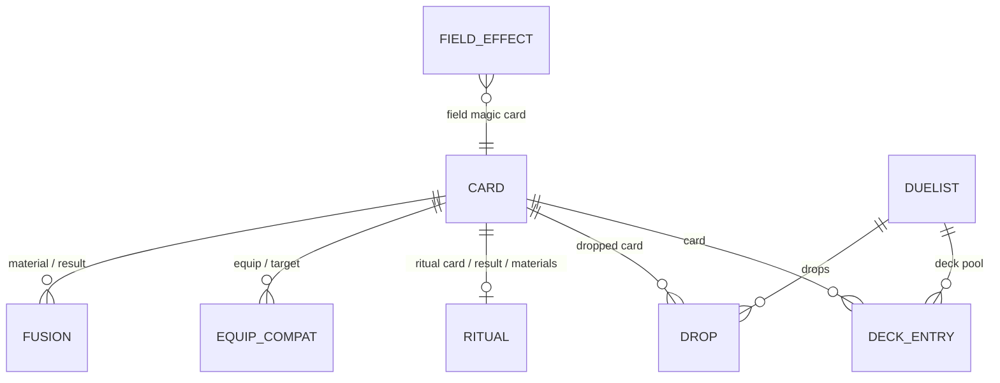

# 02 – Catalog data model and organization

> **Status: Mostly built** (catalog `0.2.0`). Game facts were verified against game-data sources before they were coded (§6). Items still waiting on a TBD are deferred, not guessed.

## 0. Status

Build status as of 2026-10-20, after the spec 02 build PR (based on `main` @ `d06bf94`); D-4 and D-5 rechecked after the spec 03 build PR. Legend in the [index](./README.md#status-system).

**4 built · 1 partial · 0 not built**

| ID | Item | Decision | Build | What exists today |
|---|---|---|---|---|
| D-1 | Separate entities from relations | Agreed | ✅ Built | Cards describe what a card is; ritual recipes live in `data/rituals.ts`, keyed by card ID |
| D-2 | Card entity (target shape) | Agreed | ✅ Built | `IMagicCard`/`ITrapCard`/`IEquipCard` split, flat `attack`/`defense`, `guardianStars` tuple, recipe out of `IRitualCard`. TBD-gated fields (attribute D3, magic/trap kinds D5, rarity D6) deferred |
| D-3 | Relation collections | Agreed | 🟡 Partial | Typed `fusions`, `rituals`, `equips`, `fields` (only `rituals` has data). Duelists, decks and drops wait for TBD-D9 |
| D-4 | Game rules as data | Agreed | ✅ Built | `MONSTER_TYPES` (all 20), `CARD_TYPES`, `GUARDIAN_STARS` in `src/data/enums.ts` are the single list used by the schema enums (`z.enum(MONSTER_TYPES)`) and by the TS types; rule values in `data/rules.json`, validated by the `rules` schema ([03](./03-catalog-data-authoring.md)) |
| D-5 | One organization rule for files | Agreed | ✅ Built | `data/cards/monsters/<type>.json` and `data/cards/{magic,trap,equip,ritual}.json`; no `pageN` split. The validator rejects a monster in another type's file |

## 1. Why this spec exists

Goal **G6**: the catalog must organize the data **correctly by card type and the other game concepts**. *Forbidden Memories* (FM) has its own rules, different from the modern TCG. Fusions, guardian stars, starchip costs, equip compatibility and duelist drops are what players actually look up. If the model does not capture these concepts as first-class data:

- the query API ([04](./04-catalog-query-api.md)) cannot answer the questions players ask ("what can I fuse with X?", "who drops Y?");
- the site ([06](./06-site-ux-forbidden-memories.md)) cannot reproduce the feel of the in-game card screens;
- adding these concepts later would change the shape of every card, which is a breaking change for npm consumers.

Designing the full shape now (even if most of it stays empty) lets the data grow **without breaking changes**.

## 2. What exists today

> **Updated by the spec 02 build (catalog `0.2.0`).** The model below is the one shipped in `0.2.0`. Since spec 03 the data files are JSON in `catalog/data/` at the same paths (`.json` instead of `.ts`), and the rules are in `data/rules.json`. The snapshot that follows it, and §3 Gaps, describe the model **before** this spec was built and are kept for history.

```ts
// data/enums.ts: runtime lists in the game's own order; the TS types derive from them
MONSTER_TYPES = ["Dragon", "Spellcaster", …, "Plant"] as const   // all 20
CARD_TYPES    = ["Monster", "Magic", "Trap", "Ritual", "Equip"] as const
GUARDIAN_STARS = ["Mars", "Jupiter", "Saturn", "Uranus", "Pluto", "Neptune", "Mercury", "Sun", "Moon", "Venus"] as const

// data/card-types.ts
ICardBase    { id: CardId, name, password: { code, cost }, description }
IMonsterCard { cardType: "Monster", monsterType, level, attack, defense, guardianStars: [TGuardianStar, TGuardianStar] }
IMagicCard   { cardType: "Magic" }    ITrapCard { cardType: "Trap" }    IEquipCard { cardType: "Equip" }
IRitualCard  { cardType: "Ritual" }   // recipe in data/rituals.ts
ICard = IMonsterCard | IMagicCard | ITrapCard | IEquipCard | IRitualCard

// data/relation-types.ts
IFusion      { materials: [CardId, CardId] /* sorted, a <= b */, result }
IRitual      { ritual, result, materials: CardId[] }
IEquipCompat { equip, targets: CardId[], boost }
IFieldEffect { field, boosts: TMonsterType[], weakens: TMonsterType[], amount }

// data/rules.ts
TOTAL_CARDS = 722; GUARDIAN_STAR_ADVANTAGE = { Mars: "Jupiter", …, Mercury: "Sun" }; GUARDIAN_STAR_BONUS = 500
```

```
catalog/src/data/
├── cards/
│   ├── monsters/<monster-type>.ts   # thunder.ts today; a card in the wrong type file is a type error
│   ├── magic.ts  trap.ts  equip.ts  ritual.ts
│   └── index.ts                     # merges every file, sorts by id
├── fusions/index.ts   equips.ts   fields.ts   rituals.ts
├── duelists/                        # still empty (TBD-D9)
├── enums.ts   rules.ts   card-types.ts   relation-types.ts
```

Public API additions: `getRitual(ritualOrResultId)`, `TOTAL_CARDS`, `MONSTER_TYPES`, `CARD_TYPES`, `GUARDIAN_STARS`, `GUARDIAN_STAR_ADVANTAGE`, `GUARDIAN_STAR_BONUS`. The migration notes are in `catalog/CHANGELOG.md`.

**Before the spec 02 build:** `catalog/src/data/card-types.ts` (details in `ARCHITECTURE.md` §4.1):

```ts
type TSupportCardType = "Equip" | "Magic" | "Trap";
type TCardType       = TSupportCardType | "Monster" | "Ritual";
type TMonsterType    = "Thunder" | "Dragon";               // only 2 of the game's types
type TGuardianStars  = "Sun" | "Mercury" | "Venus" | "Moon" | "Mars"
                     | "Jupiter" | "Saturn" | "Uranus" | "Neptune" | "Pluto";

ICardBase     { id, name, password: { code, cost }, description }
IMonsterCard  { cardType: "Monster", level, monsterType, monsterPoints: { attack, defense }, guardianStars: { first, second } }
IRitualCard   { cardType: "Ritual", summon: { monsterResultId, monsterMaterialIds[] } }
ISupportCard  { cardType: "Equip" | "Magic" | "Trap" }
ICard = IMonsterCard | IRitualCard | ISupportCard          // discriminated on cardType
```

Folder organization:

```
cards/
├── monsters/thunders/page0..3.ts   # Thunder monsters, split by ID range
├── rituals/page0..3.ts             # Rituals, split by ID range (665–721)
└── support/{equip,magic,trap}.ts
duelists/                            # empty placeholder
```

**Data entered: 5 cards** (IDs 315 Dragon Treasure, 332 Mountain, 425 Thunder Dragon, 674 Beastry Mirror Ritual, 690 Fake Trap). (`ARCHITECTURE.md` §7.1 said 6; corrected to 5.)

**What is already good and should be kept:**
- The discriminated union on `cardType`, which gives type narrowing for free.
- `id` = in-game card number (the natural key).
- Cross-references use plain IDs (`monsterResultId`, `monsterMaterialIds`), so the data stays flat and serializable.
- The model follows FM's concepts (guardian stars, starchips), not the modern TCG's.

## 3. Gaps

| # | Gap |
|---|---|
| D-gap-1 | `TMonsterType` lists 2 types. FM has about 20 (**TBD-D1**). |
| D-gap-2 | Folder organization differs by category: monsters are grouped by type and then by ID range, rituals only by ID range, support only by type. A contributor has to learn three rules. |
| D-gap-3 | The ID ranges in the `pageN.ts` headers are not verified and do not appear in any game list. For example, `thunders/page0.ts` covers "045–371", which is a very wide range for one type. Their meaning is unclear (**TBD-D4**). |
| D-gap-4 | No **fusion** data, the core mechanic of FM. |
| D-gap-5 | No **equip compatibility** (which monsters each equip card can target, and the boost). |
| D-gap-6 | No **field-card effects** (for example, Mountain boosts Dragon, Winged Beast and Thunder). |
| D-gap-7 | No **duelist** data (decks, drop tables). The folder exists but is empty. |
| D-gap-8 | Magic and Trap have no sub-classification (field, damage, heal, destroy, power-up and so on). |
| D-gap-9 | No **attribute** field. `ARCHITECTURE.md` says FM has no attributes. Some community databases list attributes for FM cards, so this needs verifying (**TBD-D3**). |
| D-gap-10 | The game's rules are not data: the guardian-star advantage cycle and the total card count (`721` is hard-coded in the site, while FM is believed to have 722). |

## 4. Proposed improvements

### D-1 Separate *entities* from *relations* · ✅ Built
Card records describe **what a card is**. Game mechanics that link cards (fusions, equips, rituals, drops) live in their **own collections**, keyed by ID. The reasons:

- one fusion involves 2–3 cards, so storing it inside a card would duplicate it;
- relations can be filled in independently, by different contributors, at different times;
- the card shape stays stable while relation data grows.



### D-2 Card entity (target shape) · ✅ Built

```ts
interface ICardBase {
  id: CardId;                 // 1..TOTAL_CARDS, in-game number
  name: string;               // English name; see TBD-X2 for localization
  description: string;
  password: { code: string; cost: number };   // code: 8 digits; cost: starchips
  // TBD-D6: rarity / in-game "card number" display. Artwork lives in data/images.json (spec 08), not on the card
}

interface IMonsterCard extends ICardBase {
  cardType: "Monster";
  monsterType: TMonsterType;           // full list, TBD-D1
  level: number;                       // 1..12
  attack: number; defense: number;     // flatten monsterPoints? TBD-D7
  guardianStars: [TGuardianStar, TGuardianStar];
  attribute?: TAttribute;              // TBD-D3
}

interface IMagicCard extends ICardBase {
  cardType: "Magic";
  magicKind?: TMagicKind;              // TBD-D5: "Field" | "Damage" | "Heal" | "Destroy" | "PowerUp" | ...
}
interface ITrapCard   extends ICardBase { cardType: "Trap";  trapKind?: TTrapKind }   // TBD-D5
interface IEquipCard  extends ICardBase { cardType: "Equip" }
interface IRitualCard extends ICardBase { cardType: "Ritual" }   // the recipe moves to rituals.ts (D-3)

type ICard = IMonsterCard | IMagicCard | ITrapCard | IEquipCard | IRitualCard;
```

Splitting `ISupportCard` into `IMagicCard`, `ITrapCard` and `IEquipCard` lets each one gain its own fields without optional-field sprawl.

**Compatibility:** renaming or flattening fields (`monsterPoints` → `attack`/`defense`, the `guardianStars` object → tuple, `summon` moving out) is **breaking**. Either do it in a `0.x` minor (allowed under semver for 0.x) with a migration note, or keep the old fields as deprecated getters for one release (**TBD-D7**).

**Built:** as proposed, in catalog `0.2.0` with a migration note in `catalog/CHANGELOG.md` (TBD-D7) and no deprecated getters. `ISupportCard` remains as the union `IMagicCard | ITrapCard | IEquipCard`. `attribute`, `magicKind`/`trapKind` and rarity are **not** added until TBD-D3, TBD-D5 and TBD-D6 are resolved.

### D-3 Relation collections · 🟡 Partial

**Built:** `IFusion`, `IRitual`, `IEquipCompat` and `IFieldEffect` (`data/relation-types.ts`), with collections `fusions/index.ts`, `rituals.ts` (holding the one known recipe), `equips.ts` and `fields.ts`. `getRitual()` reads `rituals`. **Not built:** `IDuelist`, `IDeckEntry` and `IDrop` wait for TBD-D9.

`IFusion` follows the resolved TBD-D2: the game stores **only specific card pairs**, so there is no `MaterialRef`.

```ts
// fusions/  (as built)
interface IFusion {
  materials: [CardId, CardId];   // order-insensitive: stored sorted (a <= b), one entry per pair; a card may fuse with itself
  result: CardId;
}
```

The original proposal, kept for reference:

```ts
// fusions/*.json  (proposal before TBD-D2 was resolved)
interface IFusion {
  result: CardId;
  materials: [MaterialRef, MaterialRef];       // order-insensitive
}
type MaterialRef =
  | { card: CardId }                           // specific card
  | { monsterType: TMonsterType }              // "any Dragon"   ┐ TBD-D2: how generic fusions
  | { group: string };                         // "any Female"   ┘ are expressed in FM

// equips.json
interface IEquipCompat { equip: CardId; targets: CardId[]; boost: number }  // boost usually 500, TBD-D8

// rituals.json  (moved out of IRitualCard.summon)
interface IRitual { ritual: CardId; result: CardId; materials: CardId[] }

// fields.json
interface IFieldEffect { field: CardId; boosts: TMonsterType[]; weakens: TMonsterType[]; amount: number } // TBD-D8

// duelists/*.json
interface IDuelist { id: string; name: string; campaignStage?: string /* TBD-D9 */ }
interface IDeckEntry { duelist: string; card: CardId; weight: number }
interface IDrop {
  duelist: string; card: CardId; weight: number;
  rank: "S/A-POW" | "B/C/D" | "S/A-TEC"        // TBD-D9: rank categories
}
```

### D-4 Game rules as data (`rules.json` + schema enums) · ✅ Built

The rules split across two places:

- **Enumerations** (card types, monster types, guardian stars) are defined **in the schema** ([03](./03-catalog-data-authoring.md) A-1), for example `z.enum([...])`. Every TS type and the JSON Schema `enum` derive from that one list, and the API re-exports it as runtime arrays (`MONSTER_TYPES`, …) for the site's filters.
- **Game rule values** are data, in `data/rules.json`, validated by the same schema:

```json
{
  "$schema": "../schema/rules.schema.json",
  "totalCards": 722,
  "guardianStarAdvantage": { "Sun": "Moon", "Moon": "Venus" },
  "guardianStarBonus": 500
}
```

(`totalCards`: confirm 722 vs 721, TBD-D10. The advantage map is partial and unverified, TBD-D11.)

**Built:** both TBDs are resolved (§6). The enums are `as const` lists in `src/data/enums.ts` (`MONSTER_TYPES`, `CARD_TYPES`, `GUARDIAN_STARS`, in the game's own order). The TS types derive from them, and the schema reuses the same lists (`z.enum(MONSTER_TYPES)` in `catalog/schema/schemas.ts`, [03](./03-catalog-data-authoring.md) A-1), so there is one source. The rule values live in `catalog/data/rules.json`, validated by the `rules` schema: `totalCards: 722`, the full `guardianStarAdvantage` map (each star → the star it beats) and `guardianStarBonus: 500` (+500 for the advantaged card, −500 for the other). The API exports them as `TOTAL_CARDS`, `GUARDIAN_STAR_ADVANTAGE` and `GUARDIAN_STAR_BONUS`.

### D-5 One organization rule for files · ✅ Built
Today there are three different rules (see D-gap-2). Proposal: **one folder per `cardType`, one file per sub-type**:

```
data/
├── cards/
│   ├── monsters/<monster-type>.json    # dragon.json, thunder.json, spellcaster.json, ...
│   ├── magic.json                      # (or magic/<kind>.json, if TBD-D5 resolves to sub-kinds)
│   ├── trap.json
│   ├── equip.json
│   └── ritual.json
├── fusions/  (split by result monster type, to keep files small)
├── equips.json
├── rituals.json
├── fields.json
├── duelists/
└── rules.json
```

Drop the `pageN.ts` ID-range split. ID order is restored by a single sort in the loader, and file size is controlled by sub-type instead. Each file in this layout is a **JSON** file (`.json`, not `.ts`), as agreed in [03](./03-catalog-data-authoring.md) A-1. The TypeScript interfaces above describe the shape that the JSON schema enforces.

*Alternative (if TBD-D4 shows that pages map to something real, such as the in-game library pages):* keep `pageN` but apply it to **every** category consistently.

**Built:** the main proposal, as JSON files at the target paths under `catalog/data/` (`cards/monsters/<type>.json`, `cards/{magic,trap,equip,ritual}.json`, `fusions/<type>.json`, `rituals.json`, `equips.json`, `fields.json`, `rules.json`). They were `.ts` files after the spec 02 build and were converted by [03](./03-catalog-data-authoring.md) A-1 without changing the layout. The `pageN` split is gone (TBD-D4 is moot). The validator rejects a monster in another type's file and file names that are not a monster type. Only `thunder.json` exists today; a type's file is created with its first card, with no code change.

## 5. Acceptance criteria

- [x] `TMonsterType`, `TGuardianStar` and `TCardType` are derived from the schema enums, and game rule values live in `data/rules.json`. *(The types and the Zod enums derive from the same `as const` lists in `src/data/enums.ts`; the rules are in `catalog/data/rules.json` since spec 03.)*
- [ ] Every FM concept listed in D-3 has a typed collection, even if it is still empty. *(Fusions, rituals, equips and fields: yes. Duelists, decks and drops: deferred, TBD-D9.)*
- [x] A contributor can find where any card belongs from **one** rule (D-5).
- [x] `TOTAL_CARDS` comes from the library. The site no longer hard-codes 721.
- [x] Every TBD in §6 is resolved, or explicitly deferred, before its part of the model is coded.

## 6. TBD / open questions

> To fill in: when a TBD is resolved, record the **answer and its source** here.

Sources for the resolved items, checked 2026-10-20. They were preferred when derived from the game data (US release, SLUS_014.11):
- **[Decomp]** [Yu-Gi-Oh-Forbidden-Memories-Recompiled](https://github.com/Unchiga/Yu-Gi-Oh-Forbidden-Memories-Recompiled), a decompilation of the US executable (`notes/card-catalog.md`, `src/game/duel_calc_guardian_star_matchup.c`, `notes/research/fusion-and-drop-tables/`).
- **[FusionCalc]** [Solumin/YGO-FM-FusionCalc](https://github.com/Solumin/YGO-FM-FusionCalc), with `data/types_and_stars.js` and `data/Cards.json` (a game-data dump).
- **[DataCrystal]** [Data Crystal ROM map](https://datacrystal.tcrf.net/wiki/Yu-Gi-Oh!_Forbidden_Memories/ROM_map).
- **[fmlib]** [forbidden-memories-coding/fmlib-cpp](https://github.com/forbidden-memories-coding/fmlib-cpp), a randomizer library that reads the fusion table.

| ID | Question | Answer / current belief |
|---|---|---|
| ~~**TBD-D1**~~ | Full list of FM monster types | **Resolved: exactly 20**, spelled Dragon, Spellcaster, Zombie, Warrior, Beast-Warrior, Beast, Winged Beast, Fiend, Fairy, Insect, Dinosaur, Reptile, Fish, Sea Serpent, Machine, Thunder, Aqua, Pyro, Rock, Plant (type IDs 0–19). They are followed by the non-monster labels Magic, Trap, Ritual and Equip (20–23). Sources: [Decomp], [FusionCalc]. Built as `MONSTER_TYPES` / `CARD_TYPES` |
| ~~**TBD-D2**~~ | How to model "generic" fusions (type-based, or group-based like "Female"), and how fusion priority works when several results match | **Resolved: the game stores only specific card pairs** (each first card has a list of (partner, result) entries, 25,131 in total). Type and group "rules" are a community summary of that table, not game data. Fusions are **order-insensitive**: the game sorts both inputs, and each pair is stored once under the lower ID. Self-pairs exist. Sources: [Decomp], [DataCrystal], [fmlib], [FusionCalc] `Cards.json`. Built as `IFusion { materials: [a, b] (a <= b), result }`. Priority with several matches does not arise for a single pair; chained fusions are a query concern ([04](./04-catalog-query-api.md) Q-5) |
| **TBD-D3** | Does FM have card attributes that matter (or are at least shown)? | Unclear. Listed in some databases, possibly unused in gameplay. **Deferred**: no `attribute` field yet |
| ~~**TBD-D4**~~ | What do the `pageN.ts` ID ranges mean, and are they correct? | **Moot:** the `pageN` split was dropped by D-5 |
| **TBD-D5** | Sub-classification of Magic and Trap cards (field, damage, heal, destroy, power-up, ...) | Needed for filters. The categories are not settled. **Deferred**: no `magicKind`/`trapKind` yet |
| **TBD-D6** | Extra card fields: rarity, Japanese/PAL names | Artwork reference resolved: a separate relation file, `data/images.json` ([08](./08-card-images.md) I-2). **Deferred**: no rarity or localized names yet |
| ~~**TBD-D7**~~ | Breaking-change strategy for reshaping fields (D-2) | **Applied: `0.2.0` with a migration note** in `catalog/CHANGELOG.md`, no deprecated getters |
| **TBD-D8** | Equip boost values (+500 typical, larger for some cards?) and field-effect amounts | Open. The shapes (`boost`, `amount`) are built; no values are entered |
| **TBD-D9** | Duelist list, campaign stages, drop rank categories, and whether we store drop weights or percentages | Open. **Deferred**: no duelist, deck or drop types yet. (The game's drop table is in the [Decomp] fusion-and-drop-tables notes, which is a starting point) |
| ~~**TBD-D10**~~ | Total card count: 722 or 721? | **Resolved: 722**, IDs 1–722. #1 is "Blue-eyes White Dragon" (the game's spelling) and #722 "Magician of Black Chaos". Sources: [Decomp] card catalog (722 rows), [FusionCalc] `Cards.json` (722 entries), [DataCrystal] (the drop routine loops over 722 cards), and the Fandom gallery (001–722, [08](./08-card-images.md) §2). Built as `TOTAL_CARDS = 722` |
| ~~**TBD-D11**~~ | Guardian-star advantage cycle and bonus | **Resolved:** two cycles that never interact: Mars→Jupiter→Saturn→Uranus→Pluto→Neptune→Mars and Sun→Moon→Venus→Mercury→Sun ("A→B": A beats B). In battle the advantaged card gets **+500** and the disadvantaged card **−500**, applied to both the ATK and the DEF calculation. Sources: [Decomp] `duel_calc_guardian_star_matchup.c` (constant 500, two cycles, ±500), plus a community forum thread for the cycles. Only the decompilation shows the −500 side. Built as `GUARDIAN_STAR_ADVANTAGE` and `GUARDIAN_STAR_BONUS = 500` |

Data note from the same sources: monster levels run 1–12 (no card has level 10), and non-monster cards have no guardian star or level, which matches the model.
