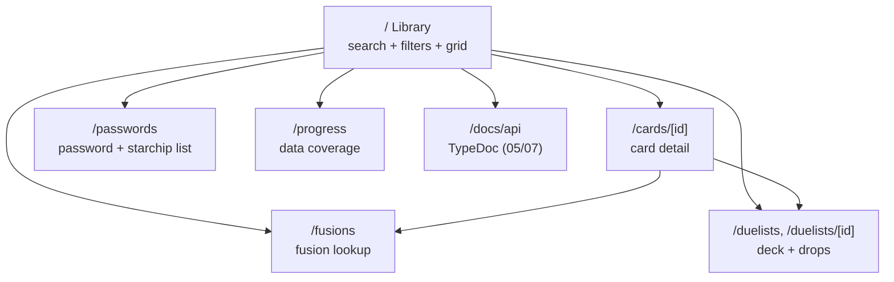

# 06 – Site UI/UX inspired by Yu-Gi-Oh! Forbidden Memories

> **Status: Proposed.** Visual direction and page list. Final visuals need a design pass (mock-ups) before they are built.

## 0. Status

Build status as of 2026-10-20, `main` @ `9a353ee`. Legend in the [index](./README.md#status-system).

**0 built · 2 partial · 3 not built** · 1 n/a

| ID | Item | Decision | Build | What exists today |
|---|---|---|---|---|
| U-1 | Visual language inspired by FM | Proposed | ❌ Not built | Default MUI light theme |
| U-2 | Information architecture (pages) | Proposed | 🟡 Partial | One page: a coverage grid (becomes `/progress`) |
| U-3 | Interaction details | Proposed | ❌ Not built | Only an "Only Available" switch; no search, keyboard or virtualization |
| U-4 | Site technology stack | TBD | ➖ N/A | Today: Next.js 15 + MUI 6 (decision deferred, TBD-U1) |
| U-5 | Static generation and SEO | Proposed | 🟡 Partial | Static export works; no per-card pages, meta tags or sitemap |
| U-6 | Migration of the current page | Proposed | ❌ Not built | Page still at `/` |

## 1. Why this spec exists

Goal **G1**: the project keeps a **site that displays the catalog data** with **a good UI/UX based on *Yu-Gi-Oh! Forbidden Memories***. The site is how most people will meet the project. Players of a 1999 PS1 game come for:

- **look-ups** they used to do on old fan pages: card stats, passwords, fusions, drops;
- **nostalgia**: the game's dark-blue menus, gold-framed windows and Egyptian motifs.

A generic Material UI grid (what exists today) serves neither well. A themed, search-first site does. It also acts as the **reference consumer** of the npm API ([04](./04-catalog-query-api.md)): every screen is built from public functions only.

## 2. What exists today

`mkt_site/` (Next.js 15, static export, MUI 6 + Toolpad; see `ARCHITECTURE.md` §5):

- One page, `pages/index.tsx`, titled "Cards registered".
- It renders `TOTAL_CARDS = 721` slots and calls `getCard(id)` for each one.
- Each slot is an MUI `Card` showing `#id`, name, description, card type, password code and cost. Missing cards show "Not available yet" in red, or are hidden by the **Only Available** switch (on by default).
- MUI's default light theme. No search, no filters, no detail page, no navigation.
- Monster stats, guardian stars and ritual recipes exist in the data but **are not shown**.

**Why it is like this** *(inferred)*: the page was built as a **coverage report** to track data entry, not as an end-user product. MUI gave a decent look without writing CSS.

## 3. Gaps

| # | Gap |
|---|---|
| U-gap-1 | No visual identity. It does not feel like FM. |
| U-gap-2 | No search or filters (name, type, monster type, stars, level, ATK/DEF, cost). |
| U-gap-3 | No card detail view, and no shareable URL per card. |
| U-gap-4 | Most fields are not shown (level, ATK/DEF, guardian stars, ritual recipe). |
| U-gap-5 | Renders 721 DOM cards at once, with an O(n) lookup each time. |
| U-gap-6 | Coverage (the page's real purpose today) is not summarized. There is no "5 / 722" progress figure. |
| U-gap-7 | No fusion, equip or duelist screens (they depend on the data in [02](./02-catalog-data-model.md)). |
| U-gap-8 | The README promises a dark/light theme, stats and responsive search that do not exist. |

## 4. Proposed improvements

### U-1 Visual language: "inspired by", not copied · ❌ Not built
Recreate the **mood** of FM with original CSS and assets:

| FM element | Site treatment |
|---|---|
| Deep navy/indigo menu backgrounds with subtle gradients | Dark-first theme. Background is navy `#0b1630`-ish with a radial vignette (TBD-U3) |
| Gold/bronze bevelled window frames | Bordered panels: a 2px gold border, an inner shadow, rounded corners |
| Card frame colors per card type | A color token per `cardType` (monster = amber/brown, magic = green, trap = magenta, ritual = blue, equip = **TBD-U4**) |
| Pixel/bitmap UI text | Pixel display font for headings and numbers only (for example "Press Start 2P" or "Silkscreen" via Google Fonts). Body text stays in a readable sans-serif |
| Guardian-star symbols | Original SVG icons, one per star, with the name in a tooltip |
| Egyptian / Millennium motifs | Light ornaments (eye-of-Horus-style divider, hieroglyph pattern at low opacity), all original |
| Card "library" list with ID numbers | The main Library page (U-2) mirrors this browse-by-number feel |
| Menu cursor and selection | Keyboard focus ring styled as the game's selection cursor |

**No Konami logos, sprites or ripped fonts are copied into the site.** Card pictures are **linked** from the Yu-Gi-Oh! Fandom wiki, never stored by us ([08](./08-card-images.md), the interim decision for TBD-X3). The **styled card frame** (type color, name, level stars, ATK/DEF, guardian-star icons) stays the default visual and is used whenever an image is missing or fails to load, so the site looks complete with or without external images.

Accessibility: WCAG AA contrast on the dark theme, `prefers-reduced-motion` respected, all actions keyboard-reachable. Optional light theme (**TBD-U5**).

### U-2 Information architecture (pages) · 🟡 Partial

| Page | Content | Depends on |
|---|---|---|
| **Library** `/` | A search box (name), filter chips (card type, monster type, guardian star, level range, ATK/DEF range, cost range), sorting (ID, name, ATK, DEF, level, cost) and a grid or list toggle. Filter state lives in the URL query string so views are shareable | `searchCards` (04 Q-4) |
| **Card detail** `/cards/[id]` | Large styled card frame, all fields, copy-password button, previous/next by ID, and related data: fusions it makes or is made from, equips, ritual recipe, which duelists drop it. **Statically generated for every ID 1..722** (missing cards render a "not catalogued yet, contribute" page) | 04 Q-1, Q-5 |
| **Fusion lookup** `/fusions` | Pick two cards and see the result. Pick a card and see every fusion it is in | 02 D-3, 04 Q-5 |
| **Duelists** `/duelists` | List of duelists and their deck pools and drop tables | 02 D-3 |
| **Passwords** `/passwords` | A sortable table of ID, name, password and cost. A quick-reference "password machine" view | existing data |
| **Progress** `/progress` | Today's coverage report, upgraded: an overall bar (`5 / 722`), per-type bars, a grid of IDs (filled or missing) linking to the contribute guide | 04 Q-6 |

Pages whose data does not exist yet (fusions, duelists) are hidden from navigation until the data lands. No empty screens ship.

### U-3 Interaction details · ❌ Not built
- **Instant search:** client-side, debounced. The whole dataset is in the bundle, so there are no requests.
- **Virtualized grid** so only visible cards render (fixes U-gap-5). The library depends on the stack (U-4); `@tanstack/virtual` has React, Vue, Svelte and Solid adapters.
- **Keyboard:** `/` focuses search, arrow keys move the selection in the grid, `Enter` opens the card, `Esc` closes. This nods to controller navigation.
- **Mobile:** single-column list, a filter drawer, and 44px touch targets.
- **Empty and loading states** in the FM style ("No cards match.").
- **Optional sound effects** (menu blip), **off by default**, using original sounds only (**TBD-U6**).

### U-4 Site technology stack (**TBD-U1: to be decided later**) · ➖ N/A

The stack (framework, UI/component library, styling) is **not decided yet**. Today's site uses **Next.js + MUI** (§2), and that is one candidate among others. This spec fixes only the **requirements** any stack must meet, so the choice can be made later without changing the UX defined in U-1 to U-3.

**Requirements for the stack:**

| # | Requirement | Why |
|---|---|---|
| S-1 | Produces a **fully static** build (HTML/JS/CSS files) | GitHub Pages has no server ([07](./07-site-github-pages-delivery.md)) |
| S-2 | Pre-renders **one page per card** (`/cards/1` … `/cards/722`) and per duelist at build time | Shareable URLs and SEO (U-5) |
| S-3 | Supports a configurable **base path** (`/yugioh-fb-catalog/`) | Pages project sites live under `/<repo>/` |
| S-4 | Consumes the catalog **only through its public npm API** ([04](./04-catalog-query-api.md)), and can use the local workspace copy ([01](./01-repository-and-workspaces.md) R-1) | The site is the reference consumer |
| S-5 | Allows full **custom theming** (design tokens for card-type colors, stars, fonts) | The FM look (U-1) must not be fought against |
| S-6 | Accessible interactive components: dialogs, sliders, chips, menus | U-3 and the acceptance criteria |
| S-7 | TypeScript, strict mode | Same quality bar as the catalog |
| S-8 | Can meet the Lighthouse targets in §5 | Performance on mobile |

**Candidates** (examples, not a decision):

| Layer | Candidates | Notes |
|---|---|---|
| Framework | **Next.js** (current, static export), Astro, Vite + React with a pre-render step, SvelteKit (static adapter) | Must meet S-1 to S-3 |
| UI / components | **MUI** (current) with a full custom theme, headless primitives (Radix, Ark UI) with custom styles, Chakra, Mantine | MUI is fast to build with but has a strong "Material" look (S-5). Headless options give full visual control |
| Styling | MUI theme / Emotion (current), CSS Modules, vanilla-extract, Tailwind | Tokens defined once in a theme file, whatever the tool |

**Rules until the stack is decided:**
- UX and visual specs (U-1 to U-3, U-5) are written stack-neutral and stay valid whatever is chosen.
- No new site features are built on the current stack beyond what is needed to keep it working, so nothing is thrown away if the stack changes.
- The decision is recorded in this section (and in the [index](./README.md) decision log), with the reasons and a check against S-1 to S-8.

### U-5 Static generation and SEO · 🟡 Partial
- Every `/cards/[id]` and `/duelists/[id]` page is generated at build time (S-2). For example, `generateStaticParams` in Next.js, `getStaticPaths` in Astro, or `entries` in SvelteKit.
- A `<title>` and meta description per card ("Thunder Dragon – Lv5 Thunder – 1600/1500 – Yu-Gi-Oh! FM Catalog"), plus Open Graph tags.
- `sitemap.xml` generated at build time.

### U-6 Migration of the current page · ❌ Not built
The current "Cards registered" page becomes **/progress** (U-2), so the coverage use case is kept.

## 5. Acceptance criteria

- [ ] Every page uses the public catalog API only, with no imports from `catalog/src/data`.
- [ ] Lighthouse: Performance ≥ 90 and Accessibility ≥ 95 on Library and Card detail (mobile).
- [ ] Filter and search state round-trips through the URL.
- [ ] `/cards/1` … `/cards/722` all exist in the static export.
- [ ] No third-party copyrighted asset is shipped in the build. Card images are only linked ([08](./08-card-images.md)), with attribution.
- [ ] Design mock-ups for Library and Card detail are approved before implementation (TBD-U2).

## 6. TBD / open questions

- **TBD-U1:** Site technology stack: framework, UI library and styling (U-4). **To be decided later.** Next.js + MUI is the current stack and one candidate; the choice must meet S-1 to S-8.
- **TBD-U2:** Who produces the mock-ups, and in what tool? Could start as a static HTML prototype.
- **TBD-U3:** Exact palette and fonts (pixel font licence must allow web use: OFL fonts are fine).
- **TBD-U4:** Frame color for Equip cards (and whether FM visually separates Equip from Magic).
- **TBD-U5:** Dark only, or dark plus light?
- **TBD-U6:** Sound effects at all?
- **TBD-U7:** Internationalization of the UI (PT-BR / EN), linked to TBD-X2 and TBD-X4.
- ~~**TBD-U8:** Card artwork.~~ **Resolved (interim, 2026-10-20):** linked from the Yu-Gi-Oh! Fandom wiki, with the styled frame as fallback. See [08](./08-card-images.md).
