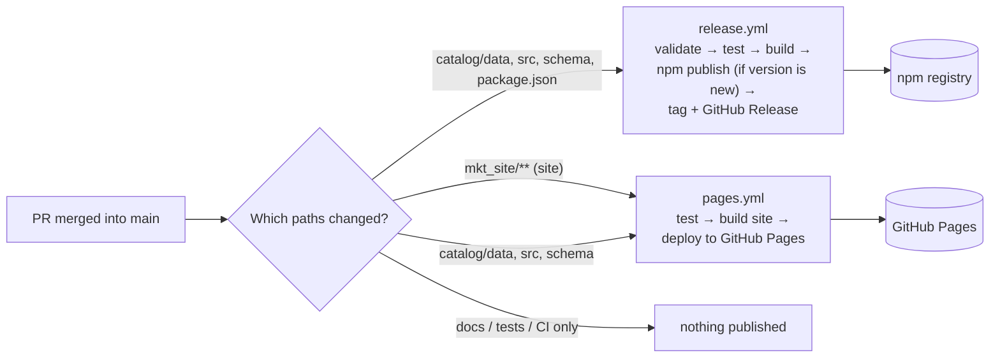
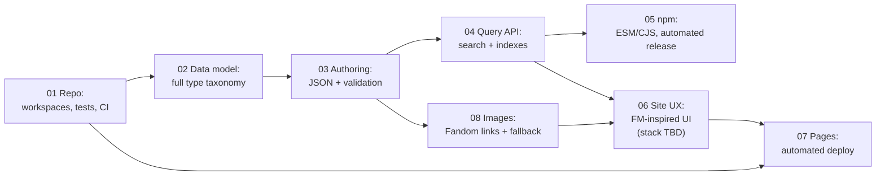

# Specs: catalog library + Forbidden Memories site

> **Status: Draft.** These specs describe the target. Each item shows what is already **built**, **partial** or **not built** (see [Status system](#status-system)). Each change should be agreed here first and then built in its own PR.

These specs turn the project goals into concrete, reviewable proposals. They build on [`../ARCHITECTURE.md`](../ARCHITECTURE.md), which describes how the code works today and why. These documents describe **where it should go next**.

## Project goals

The project keeps **one repository with two deliverables**:

| # | Goal | Build status today | Spec |
|---|---|---|---|
| G1 | A **site** that displays the catalog data, with a good UI/UX inspired by *Yu-Gi-Oh! Forbidden Memories* | 🟡 Partial: a basic MUI coverage grid exists; no FM look, search or detail pages | [06 – Site UX](./06-site-ux-forbidden-memories.md) |
| G2 | The site stays **served from GitHub Pages** | ✅ Built: live at `mhsalves.github.io/yugioh-fb-catalog` (deploy is manual) | [07 – Site delivery](./07-site-github-pages-delivery.md) |
| G3 | The catalog data is stored in a **simple format that is easy to extend** with more information later (**JSON**, agreed) | 🟡 Partial: data is saved and type-checked, but as TS literals, not JSON | [03 – Data authoring](./03-catalog-data-authoring.md) |
| G4 | The catalog stays **published on the npm registry** | ✅ Built: `@mhsalves/yugioh-fb-catalog@0.1.1` (publish is manual) | [05 – npm distribution](./05-catalog-npm-distribution.md) |
| G5 | The catalog offers **methods to search and read** the data | 🟡 Partial: 4 read/filter functions; no search | [04 – Query API](./04-catalog-query-api.md) |
| G6 | The catalog **organizes the data correctly** by card type and other game concepts | 🟡 Partial: 5 card types modeled, 2 of ~20 monster types, no fusions or duelists | [02 – Data model](./02-catalog-data-model.md) |
| — | Shared foundation: repo layout, workspaces, tests, CI | ✅ Built: Yarn workspaces, Vitest, ESLint/Prettier, `ci.yml` (version-bump check waits for 05 N-2) | [01 – Repository](./01-repository-and-workspaces.md) |
| — | Card images: free and optimized, without hosting copyrighted art ourselves | ❌ Not built: no images anywhere | [08 – Card images](./08-card-images.md) |

A goal's status says whether the **goal is met today**. Item statuses in the specs say whether each **proposed improvement** is built, so a goal can be ✅ while its spec's improvements are still ❌. For example, G2 works today, but automated deploys (07 P-1) are not built.

## How every spec is structured

Each spec uses the same sections, so you can compare them side by side:

0. **Status**: the build and decision status of every item (see [Status system](#status-system)).
1. **Why this spec exists**: the goal it serves and the reasoning behind it.
2. **What exists today**: the current implementation on `main`, with file references.
3. **Gaps**: where today's implementation falls short of the goal.
4. **Proposed improvements**: the suggested changes, each with an ID (for example `D-3`) so PRs can refer to it.
5. **Acceptance criteria**: how we will know it is done.
6. **TBD / open questions**: decisions not taken yet, or game facts not verified yet. **Nothing marked TBD should be implemented until it is resolved.**

## Status system

Every improvement item has **two independent statuses**, shown in each spec's **§0 Status** table and next to the item's heading.

**Build status: what exists in the code on `main`.**

| Badge | Meaning |
|---|---|
| ✅ **Built** | Fully implemented on `main` and meets the item's acceptance criteria |
| 🟡 **Partial** | Some of it exists on `main`. The "What exists today" column says what is missing |
| ❌ **Not built** | Nothing of it exists yet |
| ➖ **N/A** | Not a build item (a pure decision, for example the site stack) |

**Decision status: whether we agreed to build it.**

| Tag | Meaning |
|---|---|
| **Proposed** | Suggested in a spec, not agreed yet |
| **Agreed** | Accepted, ready to build |
| **TBD** | Open question; needs a decision or a verified source before building |

**Rules for keeping it true:**
- A PR that builds (or partly builds) an item **updates its badge in the same PR**: the heading, the spec's §0 table and the board below.
- An item is ✅ only when **all** of its acceptance criteria are met; otherwise it stays 🟡.
- Each spec's §0 says the date and commit the statuses were last checked against.

## Status board

Checked as of 2026-10-20, `main` @ `9a353ee`; spec 01 (and 05 N-5, 07 P-2, which it also moved) rechecked after the spec 01 build PR (based on `main` @ `750004a`).

| Spec | ✅ Built | 🟡 Partial | ❌ Not built | ➖ N/A |
|---|---|---|---|---|
| [01 – Repository, workspaces, tests and CI](./01-repository-and-workspaces.md) | 5 | 1 | 0 | 0 |
| [02 – Catalog data model and organization](./02-catalog-data-model.md) | 0 | 4 | 1 | 0 |
| [03 – Catalog data authoring (storage format and validation)](./03-catalog-data-authoring.md) | 0 | 2 | 4 | 0 |
| [04 – Catalog query API (read and search)](./04-catalog-query-api.md) | 0 | 2 | 6 | 0 |
| [05 – Catalog distribution on the npm registry](./05-catalog-npm-distribution.md) | 0 | 3 | 5 | 0 |
| [06 – Site UI/UX inspired by Yu-Gi-Oh! Forbidden Memories](./06-site-ux-forbidden-memories.md) | 0 | 2 | 3 | 1 |
| [07 – Site delivery on GitHub Pages](./07-site-github-pages-delivery.md) | 1 | 2 | 3 | 0 |
| [08 – Card images](./08-card-images.md) | 0 | 0 | 7 | 0 |
| **Total** | **6** | **16** | **29** | **1** |

## Automation rules

What runs automatically **after a PR is merged into `main`**:

| The merge changes… | npm release ([05](./05-catalog-npm-distribution.md) N-2) | GitHub Pages deploy ([07](./07-site-github-pages-delivery.md) P-1) |
|---|---|---|
| Catalog **data** (`catalog/data/**`) | ✅ publishes a **patch** | ✅ redeploys (site shows the new data) |
| Catalog **feature** (`catalog/src/**`, `catalog/schema/**`) | ✅ publishes a **minor** (or a patch for a fix) | ✅ redeploys |
| The **site** (`mkt_site/**`) | — | ✅ redeploys |
| Only docs, tests or CI config | — | — |

Every PR also runs CI ([01](./01-repository-and-workspaces.md) R-4) **before** merge. If a PR changes catalog data or code, CI requires a version bump and a changelog entry. That way the release after the merge always has a new version to publish.

Both workflows can also be started by hand (`workflow_dispatch`) to retry a failed run.

**Platform:** all of this, CI (`ci.yml`), release (`release.yml`) and deploy (`pages.yml`), runs on **GitHub Actions**. See [01](./01-repository-and-workspaces.md) R-4 for the reasons.

## Decision log

| Date | Decision | Status | Where |
|---|---|---|---|
| 2026-10-20 | **After a merge to `main`, catalog changes (new features or data) publish to npm automatically**. Mechanism: version bump required in the PR, publish on merge | **Agreed** (rule); mechanism Proposed | [05](./05-catalog-npm-distribution.md) N-2 |
| 2026-10-20 | **After a merge to `main`, site changes deploy to GitHub Pages automatically** (catalog data changes also redeploy while the site uses the workspace catalog) | **Agreed** | [07](./07-site-github-pages-delivery.md) P-1 |
| 2026-10-20 | **GitHub Actions is the CI platform** for CI, the npm release and the Pages deploy. No other CI service is used | **Agreed** | [01](./01-repository-and-workspaces.md) R-4 |
| 2026-10-20 | **npm trusted publishing (OIDC)** for releases. No `NPM_TOKEN`; provenance on every version | **Agreed** | [05](./05-catalog-npm-distribution.md) N-2b |
| 2026-10-20 | **All GitHub Actions pinned by full commit SHA** (version in a comment, updated by Dependabot, enforced in CI) | **Agreed** | [01](./01-repository-and-workspaces.md) R-4 |
| 2026-10-20 | **Rename the site folder `server/` → `mkt_site/`**. Target-state specs use `mkt_site/` | **Agreed** | [01](./01-repository-and-workspaces.md) R-6 |
| 2026-10-20 | **Spec 01 built** with these defaults for its open questions: **Yarn 1** workspaces (TBD-R2), **Node 22** for development and CI (TBD-R3, the consumer minimum stays open), site package **`yugioh-fb-catalog-mkt-site`** (TBD-R5), **plain grep** for the SHA-pin check (TBD-R6) | Built (defaults; open to change) | [01](./01-repository-and-workspaces.md) §6 |
| 2026-10-20 | **Card images are linked from the Yu-Gi-Oh! Fandom wiki** (interim). The wiki URL is stored as copied, including `?cb=`, in `data/images.json`, filled by hand per card or by an import script. No images in the repo or npm package | **Agreed** (interim) | [08](./08-card-images.md) I-1, I-2 |
| 2026-10-20 | Catalog data is stored as **JSON** files validated by a schema (cards and all relation tables) | **Agreed** | [03](./03-catalog-data-authoring.md) A-1 |
| 2026-10-20 | Site technology stack (framework, UI library, styling) is **left open**. Next.js + MUI is today's stack and one candidate. Specs list stack-neutral requirements (S-1 to S-8) instead | **TBD** (decide later) | [06](./06-site-ux-forbidden-memories.md) U-4, TBD-U1 |

## Suggested delivery order

Each step makes the next one safer. This follows the roadmap in `ARCHITECTURE.md` §8 and adds the UX and data-model work.

## Cross-cutting TBDs

These questions affect more than one spec and are tracked here once:

- **TBD-X1, source of truth for game data.** Which reference (game dump, community database, manual play-through) do we treat as authoritative for card stats, fusions and drops? See [02](./02-catalog-data-model.md) and [03](./03-catalog-data-authoring.md).
- **TBD-X2, game version/region.** NTSC-U (English), PAL (multi-language) and the Japanese release differ in names and possibly in some data. Which do we catalog? Do we support several?
- ~~**TBD-X3, card artwork.**~~ **Resolved (interim, 2026-10-20):** card images are **linked** from the [Yu-Gi-Oh! Fandom wiki gallery](https://yugioh.fandom.com/wiki/Gallery_of_Yu-Gi-Oh!_Forbidden_Memories_cards), not stored by us. The styled frame is the fallback, and self-hosting through jsDelivr is the exit plan. See [08](./08-card-images.md).
- **TBD-X4, documentation language.** The READMEs are in Portuguese, while `ARCHITECTURE.md` and these specs are in English. Pick one, or keep both with a clear rule (for example, user READMEs in PT-BR and technical docs in EN).
