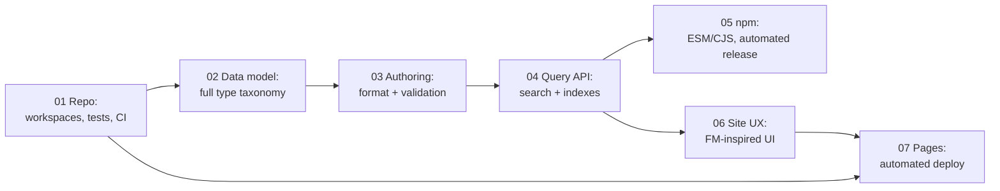

# Specs: catalog library + Forbidden Memories site

> **Status: Draft, proposal only.** Nothing in this folder has been implemented. These specs describe the target. Each change should be agreed here first and then built in its own PR.

These specs turn the project goals into concrete, reviewable proposals. They build on [`../ARCHITECTURE.md`](../ARCHITECTURE.md), which describes how the code works today and why. These documents describe **where it should go next**.

## Project goals

The project keeps **one repository with two deliverables**:

| # | Goal | Spec |
|---|---|---|
| G1 | A **site** that displays the catalog data, with a good UI/UX inspired by *Yu-Gi-Oh! Forbidden Memories* | [06 – Site UX](./06-site-ux-forbidden-memories.md) |
| G2 | The site stays **served from GitHub Pages** | [07 – Site delivery](./07-site-github-pages-delivery.md) |
| G3 | The catalog data is stored in a **simple format that is easy to extend** with more information later | [03 – Data authoring](./03-catalog-data-authoring.md) |
| G4 | The catalog stays **published on the npm registry** | [05 – npm distribution](./05-catalog-npm-distribution.md) |
| G5 | The catalog offers **methods to search and read** the data | [04 – Query API](./04-catalog-query-api.md) |
| G6 | The catalog **organizes the data correctly** by card type and other game concepts | [02 – Data model](./02-catalog-data-model.md) |
| — | Shared foundation: repo layout, workspaces, tests, CI | [01 – Repository](./01-repository-and-workspaces.md) |

## How every spec is structured

Each spec uses the same sections, so you can compare them side by side:

1. **Why this spec exists**: the goal it serves and the reasoning behind it.
2. **What exists today**: the current implementation on `main`, with file references.
3. **Gaps**: where today's implementation falls short of the goal.
4. **Proposed improvements**: the suggested changes, each with an ID (for example `D-3`) so PRs can refer to it.
5. **Acceptance criteria**: how we will know it is done.
6. **TBD / open questions**: decisions not taken yet, or game facts not verified yet. **Nothing marked TBD should be implemented until it is resolved.**

## Status legend

| Tag | Meaning |
|---|---|
| **Proposed** | Suggested in a spec, not agreed yet |
| **Agreed** | Accepted, ready to build |
| **Done** | Merged on `main` |
| **TBD** | Open question, needs a decision or a verified source |

All improvements are **Proposed** as of 2026-10-20, written against `main` @ `9a353ee`.

## Suggested delivery order

Each step makes the next one safer. This follows the roadmap in `ARCHITECTURE.md` §8 and adds the UX and data-model work.

## Cross-cutting TBDs

These questions affect more than one spec and are tracked here once:

- **TBD-X1, source of truth for game data.** Which reference (game dump, community database, manual play-through) do we treat as authoritative for card stats, fusions and drops? See [02](./02-catalog-data-model.md) and [03](./03-catalog-data-authoring.md).
- **TBD-X2, game version/region.** NTSC-U (English), PAL (multi-language) and the Japanese release differ in names and possibly in some data. Which do we catalog? Do we support several?
- **TBD-X3, card artwork.** Card art and game sprites are Konami's copyright. Do we show none, show placeholders, or link to external images? See [06](./06-site-ux-forbidden-memories.md).
- **TBD-X4, documentation language.** The READMEs are in Portuguese, while `ARCHITECTURE.md` and these specs are in English. Pick one, or keep both with a clear rule (for example, user READMEs in PT-BR and technical docs in EN).
